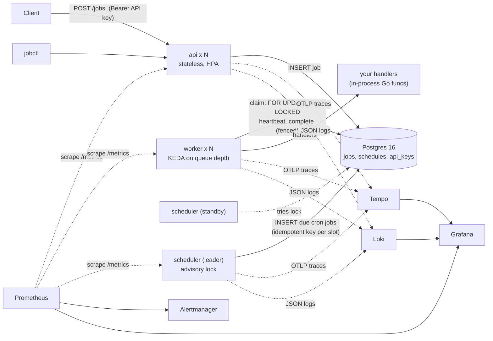
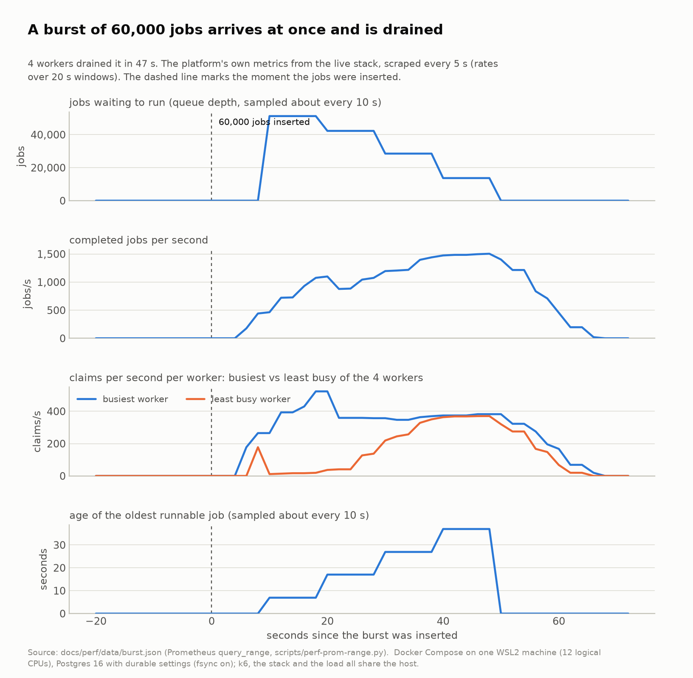
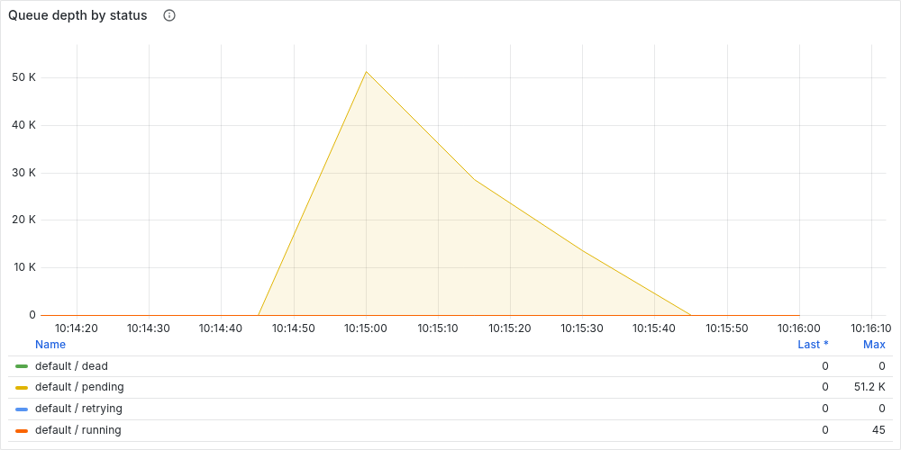
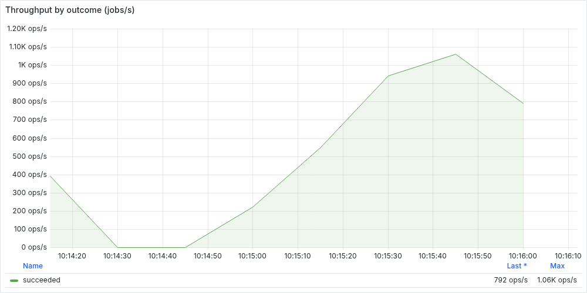
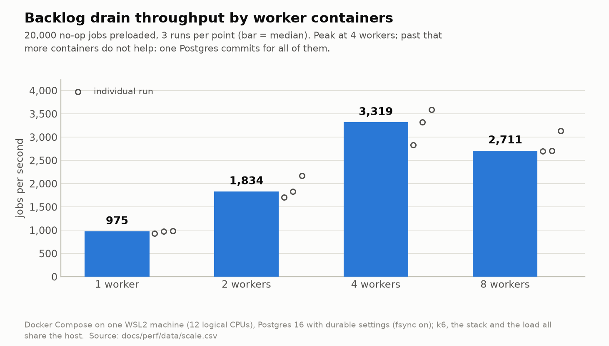
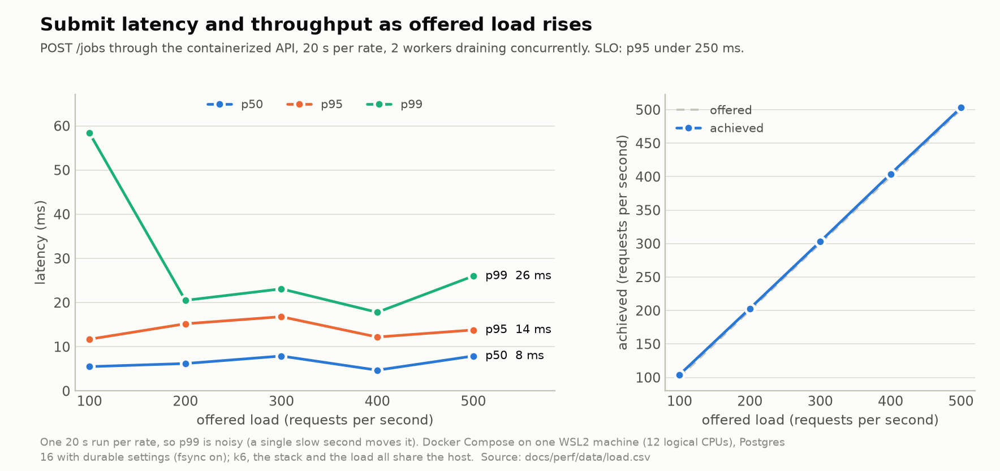
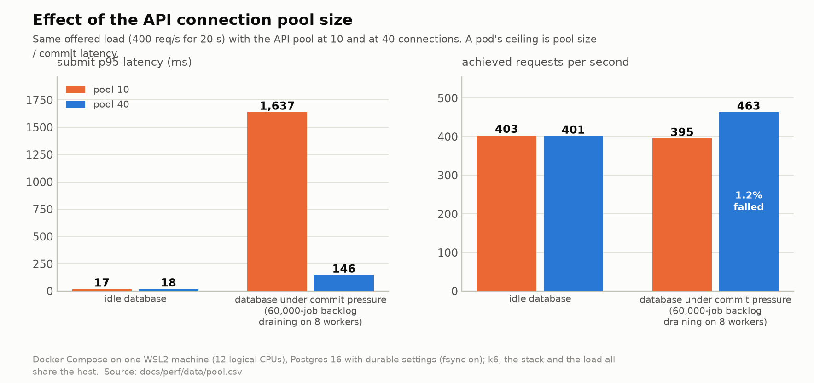
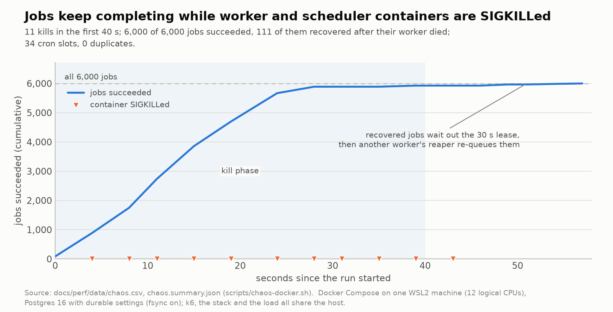
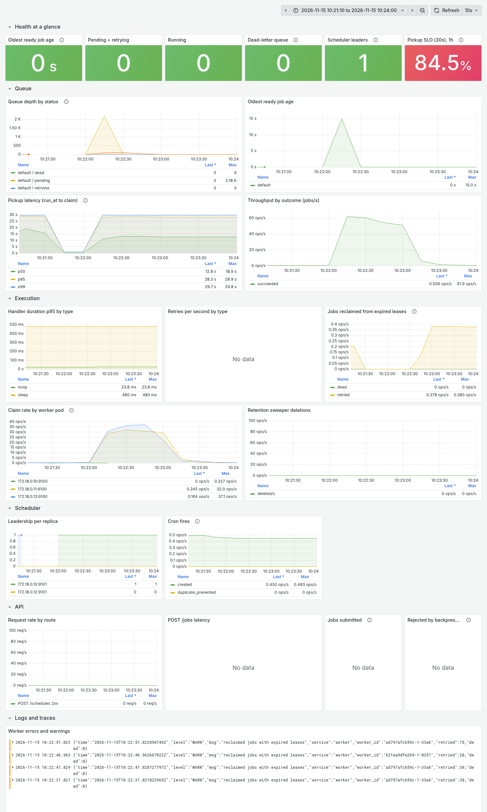

# Distributed Job Scheduler

A Postgres-backed job queue and cron scheduler in Go, in the spirit of Sidekiq and a lite Temporal. Clients submit **immediate, delayed, or cron** jobs over HTTP. A fleet of worker processes executes them across machines with **at-least-once delivery, crash recovery, retries with backoff, and graceful shutdown**.

It is built to be explained, not just run: every guarantee below has a test that tries to break it, and the design tradeoffs are written down in [docs/DESIGN.md](docs/DESIGN.md).



Postgres is the single source of truth and the only coordination mechanism. API servers and workers are stateless and scale horizontally.

## Guarantees, and the test that proves each

| Guarantee | Mechanism | Proof |
|---|---|---|
| **No job runs on two workers at once** | `SELECT ... FOR UPDATE SKIP LOCKED` claim + a lease + a fencing token on every write | 50 workers, 100,000 jobs, zero duplicate executions, zero lost ([scale_test.go](test/integration/scale_test.go)) |
| **No job is lost** | Durable INSERT; every transition is a committed UPDATE; no in-memory state | Same test, plus chaos below |
| **Crash recovery** | Heartbeats extend a lease; a reaper re-queues expired leases | Real `kill -9` chaos run ([test/chaos](test/chaos/main.go)) |
| **Zombie workers cannot corrupt results** | `complete`/`fail` are fenced on `(id, worker, attempts)` | [store_test.go](internal/queue/store_test.go) `TestStaleWorkerCannotWriteAfterReclaim` |
| **Retries with backoff** | Exponential backoff with equal jitter, `max_attempts`, then `dead` (DLQ), manual replay | [worker_test.go](test/integration/worker_test.go) |
| **Graceful shutdown** | SIGTERM stops claiming, drains in-flight jobs, releases stragglers without burning an attempt | Verified on the real process and in tests |
| **Cron never double-fires** | Row locks (`SKIP LOCKED`) + unique per-slot idempotency key; leader election is only an optimisation | 6 schedulers with election **disabled** produce exactly one job per slot ([scheduler_test.go](internal/scheduler/scheduler_test.go)) |
| **Idempotent submit** | `UNIQUE (tenant_id, idempotency_key)` | 50 concurrent submits create one job |
| **One tenant cannot starve the rest** | Per-tenant concurrency caps, token-bucket dispatch rate limits, and 429 backpressure, enforced under a row lock | 16 concurrent claimers never exceed a cap of 5; a mutation test proves the test catches a broken lock ([limits_test.go](internal/queue/limits_test.go)) |

> **At-least-once, not exactly-once.** A worker that is paused (GC, VM freeze) can keep running a handler after its lease expired and the job was reclaimed. The fence guarantees only one *result* is recorded; it cannot undo side effects. **Handlers must be idempotent.** This is the honest contract of every at-least-once queue.

## Quickstart

### With Docker (full stack: Postgres, API, workers, schedulers, Prometheus, Alertmanager, Grafana, Loki, Tempo)

```bash
make up                       # builds the 4 distroless images and starts everything
export JOBCTL_API_KEY=$(make -s key)
make build                    # builds ./bin/jobctl for the host
export JOBCTL_URL=http://localhost:8080

./bin/jobctl submit -type flaky -payload '{"succeed_on_attempt":3}'      # fails twice, then succeeds
./bin/jobctl get -wait <job-id>                                          # watch the retries
./bin/jobctl schedule create -name hello -cron '*/5 * * * *' -tz America/New_York -type log -payload '{"hi":1}'
```

Grafana: <http://localhost:3000> (dashboard "Job Scheduler"). Prometheus: <http://localhost:9090>. `make down` removes everything.

### Without Docker

```bash
export DATABASE_URL='postgres://postgres@localhost:5432/jobs?sslmode=disable'
make dev-up                   # migrates, then runs api + worker + 2 schedulers as local processes
./bin/jobctl create-key -tenant demo
```

### Built-in demo handlers

`noop`, `sleep` (`{"seconds":2}`), `fail` (`{"permanent":true}`), `flaky` (`{"succeed_on_attempt":3}`), `log`. Real applications register their own with `worker.Registry.Register(type, func(ctx, job) error)`; see [internal/handlers](internal/handlers/builtin.go).

## API

| Endpoint | |
|---|---|
| `POST /jobs` | Submit: `type`, `payload`, `queue`, `priority`, `delay_seconds` / `run_at`, `max_attempts`, `timeout_seconds`, `idempotency_key`. `201` created, `200` if the idempotency key already existed. |
| `GET /jobs/{id}` | Status, attempts, `last_error`. `404` for other tenants' jobs. |
| `POST /jobs/{id}/replay` | Re-queue a `dead` or `failed` job with a fresh attempt budget. |
| `POST /jobs` backpressure | `429` with `Retry-After: 5` when the tenant's queue hit its `max_backlog`. A retry of an already accepted `idempotency_key` still returns `200`. |
| `POST/GET/PATCH/DELETE /schedules` | Cron schedules: timezone-aware, misfire policy `fire_once` / `skip` / `fire_all`, pause/resume. |
| `GET /healthz`, `/readyz`, `/metrics` | Liveness (never touches the DB), readiness (DB ping, fails while draining), Prometheus. |

Auth is `Authorization: Bearer <key>`. The tenant always comes from the key, never from the request body.

Job states: `pending → running → succeeded`, with `retrying` (waiting for backoff), `dead` (retries exhausted, the DLQ), and `failed` (permanent error). See the state diagram in [docs/DESIGN.md](docs/DESIGN.md#3-job-state-machine).

## Fairness, rate limits and backpressure

Three optional limits per `(queue, tenant)`, set with `jobctl limits`:

```bash
jobctl limits set -queue default -tenant acme -max-running 20 -rate 50 -burst 100 -max-backlog 10000
jobctl limits set -queue emails -rate 10          # "*": every tenant without its own rule shares 10 jobs/s
```

- **`-max-running`** caps concurrent jobs, **`-rate`/`-burst`** is a token bucket on dispatch (protects a downstream API), **`-max-backlog`** makes the API return `429 Retry-After` instead of letting the queue grow without bound.
- Enforced exactly: the rule row is locked during a claim, so concurrent workers cannot race the cap or the bucket. Queues without rules pay nothing.
- Real-process check: with `max_backlog 3` and no workers, submissions 1 to 3 got `201` and 4 and 5 got `429 Retry-After: 5`; with workers started and `max_running 2`, never more than 2 jobs ran at once.

Design and tradeoffs: [DESIGN.md section 18](docs/DESIGN.md#18-per-tenant-limits-and-backpressure-rate-limited-queues); tuning: [OPERATIONS.md](docs/OPERATIONS.md#limits-and-backpressure).

## Failure demo

`make chaos` runs the real `worker` and `scheduler` binaries and `SIGKILL`s them at random while work flows, then checks the invariants. Output of an actual run (20,000 jobs, a worker killed every second, a scheduler every 4 seconds):

```
chaos: 20000 jobs, 6 workers, 2 schedulers; SIGKILL a worker every 1s, a scheduler every 4s
  t=  3s  succeeded=862    outstanding=19138  kills=3
  t= 21s  succeeded=10906  outstanding=9094   kills=26
  t= 42s  succeeded=20000  outstanding=0      kills=52

=== chaos report ===
elapsed:           46s
processes killed:  52 (SIGKILL)
jobs submitted:    20000
jobs succeeded:    20000
jobs dead/failed:  0 / 0
jobs lost:         0   (rows missing or never finished)
jobs recovered:    484   (needed >1 attempt: their worker was killed mid-job)
cron slots fired:  46   duplicates: 0   gaps: 0
PASS: nothing lost, nothing double-fired
```

484 jobs were mid-flight when their worker died. Each lost its lease, was re-queued by another worker's reaper, and ran again. Every cron second was fired exactly once through 12 scheduler crashes. Reproduce it with `make chaos` (local processes; needs `ADMIN_DATABASE_URL`), or `go run ./test/chaos -help`.

The same game against **containers** (`make up`, then `make chaos-docker`), output of an actual run:

```
chaos: 4000 jobs + cron every 2s; SIGKILL one container every 2s for 40s, then recovery
  t=  1s succeeded=200    killed=1 (last: worker-2)
  t= 26s succeeded=3941   killed=8 (last: scheduler-2)
=== chaos report ===
containers SIGKILLed: 11
jobs succeeded: 4000   dead/failed: 0   not finished: 0   recovered (attempts>1): 59
cron slots fired: 30   duplicates: 0   gaps: 0
PASS: nothing lost, nothing double-fired
```

And a graceful stop: with 8 jobs of 12 seconds running, `docker compose stop worker` took 12.2 s, both workers **exited 0** (not 137), and all 8 jobs succeeded on their first attempt. In Kubernetes, `kubectl delete pod -l app.kubernetes.io/component=worker --force` plays the same game (not run here).

## Performance

Everything in this section was **measured by [scripts/perf-collect.sh](scripts/perf-collect.sh)** against the containerized stack and drawn by [scripts/perf-charts.py](scripts/perf-charts.py); the raw data and how to read it are in [docs/perf](docs/perf/README.md) and nothing on a chart is typed in. The machine is a single WSL2 box (12 logical CPUs) running Docker Compose with Postgres 16 at its **durable defaults (`fsync=on`)**, with k6 and the load sharing it. Read these as the *shape* of the system on commodity hardware, not as a capacity claim.

| Headline (this run) | |
|---|---|
| Burst absorbed | **60,000 jobs** inserted at once, drained by 4 workers in **47 s** (about 1,300 jobs/s average, 1,500 peak) |
| Submit latency | p95 **12 to 17 ms** from 100 to 500 req/s, no failures, no throughput lost |
| Drain throughput | **975 jobs/s** with 1 worker, peaking at **3,319 jobs/s** with 4 (medians of 3 runs) |
| Crash resilience | 11 containers SIGKILLed mid-run: **6,000 of 6,000 jobs completed**, 111 recovered after their worker died, 0 cron duplicates |

### A burst arrives and is absorbed



Queue depth jumps to about 51,000 and falls to zero in under a minute while throughput ramps to about 1,500 jobs/s. The oldest runnable job's age is the single best "are workers keeping up?" signal: it grows while the backlog drains, then drops to zero. The third panel is an honest observation rather than a boast: the two workers that were already running claimed hundreds of jobs per second immediately, and the two scaled out for this test took about 30 s to reach parity (all four finish at about 370 claims/s each). The total is the sum of the four, so it is not a metrics artifact; I have not established why.

The same burst, as it appears in the Grafana dashboard that ships with the repo:




(The dashboard uses a 1-minute rate window, so its peak looks lower than the chart above, which uses 20 s.)

### Throughput by number of workers



A backlog of no-op jobs is preloaded and drained. Throughput scales to 4 workers and then **falls**: every job costs one durable commit, and one Postgres commits for all of them, so past the peak extra containers only add contention. This is the first limit you hit, and the first optimisation would be batching completion writes ([docs/OPERATIONS.md](docs/OPERATIONS.md#what-breaks-first)). Real jobs spend their time in handlers rather than the queue, so real-world scaling is far better than no-op numbers suggest.

### Submit latency as load rises



k6 submits at a fixed arrival rate (an open model: slow responses do not reduce the offered load), 20 s per rate, with 2 workers draining concurrently. Achieved throughput equals offered throughput at every rate, and p95 stays under 17 ms, far inside the 250 ms SLO. One 20 s run per rate means p99 is noisy.

### The connection pool is a hidden ceiling, but only under load



A request holds a connection for its whole durable commit, so a pod can do at most about *pool size / commit latency* requests per second. On an idle database the pool size does not matter (both sustain 400 req/s at 17 to 18 ms). While workers hammer the database with commits it matters enormously: p95 is **1,637 ms with 10 connections versus 146 ms with 40**, with 1,163 iterations dropped versus 117. That is why the shipped defaults are per component (API 40, worker 20, scheduler 5). The pool-40 run also shows **1.2% failed requests** at that extreme, which is the price of overload, shown rather than hidden.

### Failure: containers killed mid-run



A worker or scheduler container is `docker kill`ed every few seconds for 40 s while 6,000 jobs and a 2-second cron schedule run. Nothing is lost and no cron slot is duplicated. The flat stretch near 5,900 is the lease at work: jobs held by killed workers cannot be claimed until their 30 s lease expires, then another worker's reaper re-queues them and they finish.

The whole dashboard for that run:



Two things in this screenshot are worth explaining. The **"Pickup SLO" tile is red (84.5%)**, correctly: its window is one hour and includes the 60,000-job burst tests above, in which many jobs waited longer than 30 s, which is exactly the breach the SLO exists to show. And **"Jobs reclaimed from expired leases" is rising**, matching the `reclaimed jobs with expired leases` log lines at the bottom. An earlier version of this panel was flat zero while the same log lines appeared: the counter was created at its first increment, and Prometheus cannot see the jump from "no series" to its first value, so the first crash recovery on each worker was invisible (and the `WorkerCrashesDetected` alert would have missed it). Seeing the mismatch in this screenshot found the bug; fixed counters are now created at zero on startup, with a regression test.

### What these numbers do and do not say

- **They vary between runs.** An earlier run of the same script on the same machine measured 8 workers at 1,222 jobs/s and p95 71 ms at 400 req/s; the run charted here measured 2,711 jobs/s and 12 ms. Host load on a shared machine moves tail latency by an order of magnitude, so compare runs taken under similar conditions and rerun it on your own hardware.
- **Postgres is the ceiling**, as designed: one primary, one durable commit per job. That is a deliberate tradeoff for transactional guarantees, covered in [docs/DESIGN.md](docs/DESIGN.md) and [docs/OPERATIONS.md](docs/OPERATIONS.md).
- **Pickup-latency quantiles above 30 s are not reliable.** The histogram's top finite buckets are 30, 60 and 300 s, so slower waits land in one bucket and `histogram_quantile` just interpolates inside it (a 47 s burst showed a "60 s p99"). The SLO is defined at 30 s, where the buckets are exact; use the oldest-runnable-job age for long waits.
- **Prometheus is blind during a crash storm.** A container that lives less than one scrape interval is never scraped, so worker-side counters under-report while containers are killed every few seconds. The app targets are scraped every 5 s here, the burst test is kill-free, and the chaos chart is drawn from the database, which does not have this problem.
- **No-op jobs** isolate the queue's own cost. Everything is single-machine and single-database.

Reproduce: `make up`, then `./scripts/perf-collect.sh` (about 15 minutes, needs k6), `~/sdk/venv/bin/python scripts/perf-charts.py`, and for the screenshots start the renderer (`docker compose -f deploy/docker/docker-compose.yml --profile render up -d renderer`) and run `scripts/grafana-screenshots.sh` ([details](docs/perf/README.md)).

## Tests

```bash
make test         # everything with -race, including 50 workers x 100,000 jobs
make test-short   # smaller scale, for quick iteration
```

Integration tests need Postgres: set `TEST_DATABASE_URL` (admin connection string) or have Docker running (the suite starts a `postgres:16` container with testcontainers-go and skips cleanly if neither exists). Packages: unit tests for the state machine, backoff, cron planning (DST, misfire policies), config; integration tests for the store, worker, API, scheduler and election; the 100k-job scale test; an in-process crash test; trace and log assertions; a Helm render test.

## Observability

- **Metrics** (`/metrics` on every component): queue depth by status, oldest ready job age, pickup latency histogram, handler duration by outcome, retries, DLQ size, reaped (crash-recovered) jobs, scheduler leadership and cron fires, API request rate and latency.
- **Logs**: JSON via `log/slog` with `job_id`, `tenant_id`, `worker_id`, `trace_id` on every job line.
- **Traces**: one trace follows `POST /jobs → enqueue → claim → execute → complete`, even though the API and worker share no memory (the W3C `traceparent` is stored in the job row).
- **Dashboards as code**: [deploy/grafana](deploy/grafana) (generated by `gen_dashboard.py`, provisioned read-only). **Alerts**: [deploy/prometheus/alerts.yml](deploy/prometheus/alerts.yml), each linked to a [runbook](docs/runbooks/). **SLOs** with multi-window burn-rate alerting: [docs/SLO.md](docs/SLO.md).

## Deploying to Kubernetes

The Helm chart ([deploy/helm/jobscheduler](deploy/helm/jobscheduler)) provides: non-root distroless pods with read-only root filesystems and dropped capabilities; liveness probes that never touch the database and readiness probes that do; resource requests and limits; PodDisruptionBudgets; topology spread; a **`terminationGracePeriodSeconds` derived from the max job timeout** so a deploy never SIGKILLs a worker mid-drain; default-deny **NetworkPolicies**; the **migration as a Helm hook Job**; an **HPA** for the API; and **KEDA** autoscaling for workers on runnable backlog.

```bash
# kind demo with an in-cluster demo Postgres (never use that in production)
helm install js deploy/helm/jobscheduler --namespace jobs --create-namespace \
  --set postgresql.enabled=true --set image.tag=<tag>      # images default to ghcr.io/tobi6903/distributed-jobschedular
```

GitOps with Argo CD: [deploy/argocd](deploy/argocd). CI builds and scans images and commits the new tag to `values-prod.yaml`; Argo CD syncs it; rollback is `git revert`.

## CI/CD

[`.github/workflows/ci.yml`](.github/workflows/ci.yml): gofmt, vet, golangci-lint, `go mod tidy` check → full `-race` test suite against Postgres → Helm lint, kubeconform, promtool, amtool, hadolint, compose validation → build the four images, **Trivy-scan before pushing**, push to GHCR with provenance and SBOM → commit the new tag for Argo CD. Nightly [chaos](.github/workflows/chaos.yml) and on-demand [k6 load test](.github/workflows/perf.yml) workflows.

## Repository layout

```
cmd/{api,worker,scheduler,jobctl}      thin main(): config, wiring, signals
internal/job                            domain: Job, status state machine, backoff (no I/O)
internal/queue                          Postgres store: claim, heartbeat, fenced complete/fail, reaper, API keys
internal/worker                         poll loop, handler registry, heartbeats, shutdown
internal/scheduler                      cron parsing + misfire planning, fire transaction, leader election
internal/api                            HTTP handlers, auth, validation
internal/{metrics,telemetry,config,migrate,handlers,testdb}
migrations/                             versioned SQL, each with a tested down migration
deploy/{docker,helm,argocd,prometheus,alertmanager,grafana,loki,promtail,tempo}
test/{integration,chaos,load,helm}
docs/                                   DESIGN.md, OPERATIONS.md, SLO.md, runbooks/
```

## Documentation

- [docs/GUIDE.md](docs/GUIDE.md): **start here**: the system explained from first principles, a code tour, failure walkthroughs, interview Q&A and a demo script
- [docs/DESIGN.md](docs/DESIGN.md): architecture, state machine, schema, the exact claim query, failure modes, tradeoffs
- [docs/OPERATIONS.md](docs/OPERATIONS.md): configuration, sizing, scaling limits, **what breaks first**, day-2 operations
- [docs/SLO.md](docs/SLO.md) and [docs/runbooks/](docs/runbooks/)
- [CLAUDE.md](CLAUDE.md): conventions used while building this

## Verification status

Everything below was executed, on Linux with Docker 29, a 3-node kind cluster (Kubernetes 1.37), Go 1.26 and Postgres 16.

| Verified by running it | Not verified |
|---|---|
| **The full test suite (220 tests, 0 skipped) through testcontainers with `-race`**, including 50 workers x 100k jobs | The `images` job end to end: the Trivy gate failed on the first CI run (a misconfigured gate, not a vulnerability, see below), is fixed, and has not run again yet; so the push to GHCR and the GitOps tag commit (`promote`) are unproven |
| **The four images**: BuildKit build, non-root, no shell, 22 to 35 MB, **Trivy: 0 fixable HIGH/CRITICAL** | A managed cloud Kubernetes, a real ingress controller, an external database and real secret management (the kind cluster uses an in-cluster demo Postgres) |
| **The full Compose stack**: `make smoke` passes (retry, cron, Prometheus scrapes all replicas, one scheduler leads, one trace spans the API and worker containers in Tempo); all 25 rules healthy; all 28 dashboard panels' queries run; JSON logs reach Loki | Grafana against a real Kubernetes cluster (dashboards and screenshots come from the Compose stack) |
| **Graceful `docker stop`** mid-job (exit 0, jobs finish on attempt 1); **container chaos** (`make chaos-docker`, 11 to 14 SIGKILLs: 0 jobs lost, 0 cron duplicates, 0 gaps) | The API HPA actually scaling out (its CPU metric is read correctly, but no load pushed it over target) |
| **Kubernetes** (`make k8s-verify`, run on a fresh install): **KEDA scales workers 2 -> 8 on queue depth** and back down (8 -> 6 -> 4 -> 2); **container crashes lose nothing** (9 to 13 kills, jobs recovered, cron exact); **a rolling deploy lets in-flight jobs finish**; a job longer than the grace is **released, not lost**; **node drain** respects the PodDisruptionBudgets with the API always up and no work lost; **NetworkPolicies** block other namespaces and still allow the app to open new database connections | |
| **GitOps** (`make argocd-verify`): Argo CD deploys the chart from git (my real `AppProject` whitelist and `Application`), **heals manual drift**, **rolls out a commit** and **rolls back on `git revert`** | |
| k6 against the containerized stack at 300 jobs/s: submit p95 20 ms, p99 111 ms, 0 failures | |
| `golangci-lint` v2, `helm lint`, `kubeconform`, `promtool check` and **12 `promtool test rules` test cases**, `amtool`, `hadolint`, `actionlint` (`make validate`) | |

**On GitHub Actions (first real run of the workflows):** `test` (220 tests, `-race`), `lint` (`golangci-lint` v2), `chart` (`helm lint`, `kubeconform`, `promtool`, `amtool`, `hadolint`, compose validation) and `smoke` (the Compose stack with its chaos run) **passed**, and the **Kubernetes workflow passed end to end** (kind, KEDA, the full `k8s-verify` suite including crash chaos, rolling-deploy drain, node drain and NetworkPolicy, then the Argo CD GitOps check). The four `images` jobs failed at the Trivy step. Cause: the action ignores the severity filter for SARIF output unless `limit-severities-for-sarif` is set, so harmless `UNKNOWN`-severity Debian advisories (`tzdata`, `ca-certificates` in the base image) failed a gate meant for fixable HIGH/CRITICAL findings, and the findings were hidden inside the SARIF file. The step is now a non-failing full report to code scanning plus a gate that prints its findings.

`make validate` runs the checks that need no container runtime; `make smoke` / `make chaos-docker` run against `make up`; `make kind-up`, `make k8s-verify` and `make argocd-verify` run against kind ([deploy/kind/README.md](deploy/kind/README.md)).

Prerequisites for the Docker path: Docker with the **buildx** plugin (the Dockerfile uses BuildKit) and your user in the `docker` group.

The Grafana screenshots and performance charts in [Performance](#performance) are real (rendered from the running stack with the Grafana image renderer); regenerate them with `scripts/perf-collect.sh`, `scripts/perf-charts.py` and `scripts/grafana-screenshots.sh`.
