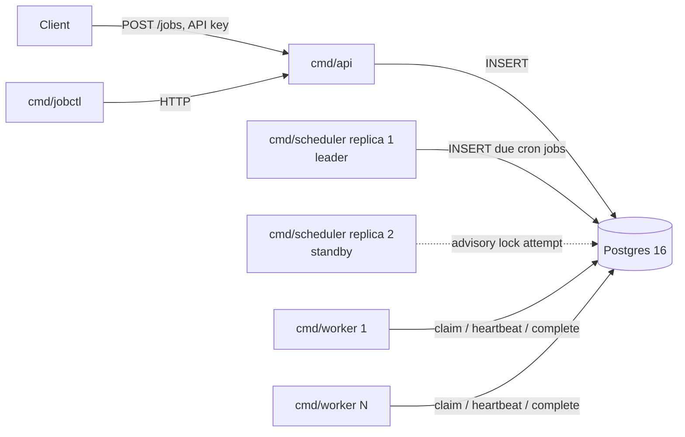
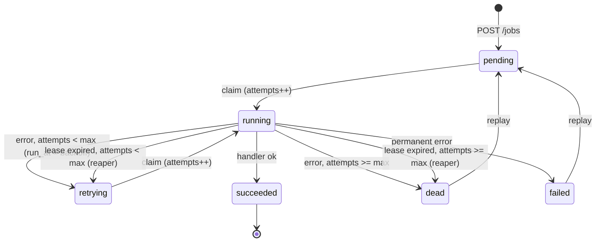

# Distributed Job Scheduler: Design

Status: **implemented (phases 0 to 7).** The design below is what was built; section 17 records where the build departed from the original plan and why, and section 16 is now the list of decisions taken.

A Postgres-backed job queue and scheduler in Go. Clients submit immediate, delayed or cron jobs over HTTP. A fleet of worker processes executes them.

## 1. Goals and non-goals

**Guarantees**

| Guarantee | How it is met |
|---|---|
| At-least-once execution | A job leaves `running` only through a fenced transition. If a worker dies, its lease expires and the job is retried. |
| No job lost | Enqueue is a durable Postgres INSERT. Every state transition is a committed UPDATE. There is no in-memory-only state. |
| No concurrent execution | Claiming uses `FOR UPDATE SKIP LOCKED`, and a lease (`locked_by`, `locked_until`) is held for the whole run. A fencing token stops stale workers from writing results. |
| Crash recovery | Heartbeats extend the lease. A reaper returns expired leases to the queue. |
| Retries with backoff | Exponential backoff with jitter, bounded by `max_attempts`, then `dead`. |
| Graceful shutdown | On SIGTERM a worker stops claiming and drains in-flight jobs. |

**Honest caveat.** "No concurrent execution" is only strictly true while leases are honoured. A paused worker (GC, VM freeze) can keep running a handler after its lease expires and the job was reclaimed. The fencing token guarantees only one result is recorded. It cannot un-run side effects. Handlers must therefore be idempotent. This is the standard at-least-once contract, and DESIGN calls it out rather than hiding it.

**Non-goals (for now):** exactly-once side effects, workflow/DAG orchestration, cross-region replication, job cancellation by API, and sub-10ms pickup latency.

## 2. Architecture



Postgres is the single source of truth and the only coordination mechanism. API servers and workers are stateless and horizontally scalable. The scheduler is the one component that needs leader election (Phase 4).

**Why Postgres and not Redis, Kafka or SQS?**
- Enqueue can happen in the same transaction as business writes. That is the basis of the outbox pattern, and Redis or SQS cannot offer it.
- Durable by default. Redis needs AOF tuning to avoid losing acknowledged jobs.
- Rich querying: list by status, tenant, or age, and replay dead jobs with plain SQL.
- Operationally one fewer system.
- Cost: throughput ceiling and vacuum pressure (section 9). Fine for thousands of jobs/sec, not hundreds of thousands.

## 3. Job state machine

States: `pending`, `running`, `succeeded`, `failed`, `retrying`, `dead`.

| State | Meaning | Claimable? | Terminal? |
|---|---|---|---|
| `pending` | Submitted, waiting for `run_at`. Delayed jobs are just `pending` with a future `run_at`. | yes, when `run_at <= now()` | no |
| `running` | Claimed by a worker holding a lease. | no (until the lease expires and the reaper moves it) | no |
| `succeeded` | Handler returned nil. | no | yes | 
| `retrying` | An attempt failed or its lease expired, attempts remain, waiting for backoff `run_at`. | yes, when `run_at <= now()` | no |
| `failed` | Handler returned a **permanent** (non-retryable) error, or the job type is unknown. | no | yes, replayable |
| `dead` | Retries exhausted (`attempts >= max_attempts`). This is the dead-letter state. | no | yes, replayable |

`pending` and `retrying` are both "waiting to run". They are separate so dashboards can tell fresh work from work that already failed once.



**Rules**
1. `attempts` is incremented at **claim** time, not at failure time. A job that crashes its worker (OOM, panic that kills the process) still consumes an attempt, so a poison-pill job cannot crash-loop forever.
2. Every transition out of `running` is fenced: `WHERE id = $1 AND status = 'running' AND locked_by = $2 AND attempts = $3`. If it affects 0 rows, the worker has lost its lease and must discard its result.
3. Replay resets `attempts = 0`, `run_at = now()`, `status = 'pending'`, and keeps `last_error` for history until the next failure overwrites it.
4. `succeeded` has no outgoing edges. It is deleted later by the retention reaper.

## 4. Schema

All timestamps are `timestamptz`. All time comparisons use the database clock (`now()`), never worker clocks, so clock skew between machines cannot cause early or late claims.

```sql
-- 000001_create_jobs.up.sql
CREATE TABLE jobs (
    id               uuid        PRIMARY KEY DEFAULT gen_random_uuid(),
    tenant_id        text        NOT NULL,
    queue            text        NOT NULL DEFAULT 'default',
    type             text        NOT NULL,                  -- handler registry key
    payload          jsonb       NOT NULL DEFAULT '{}',
    status           text        NOT NULL DEFAULT 'pending'
                     CHECK (status IN ('pending','running','succeeded','failed','retrying','dead')),
    priority         smallint    NOT NULL DEFAULT 0,        -- higher runs first
    run_at           timestamptz NOT NULL DEFAULT now(),
    attempts         integer     NOT NULL DEFAULT 0,
    max_attempts     integer     NOT NULL DEFAULT 5 CHECK (max_attempts >= 1),
    locked_by        text,
    locked_until     timestamptz,
    idempotency_key  text,
    last_error       text,
    created_at       timestamptz NOT NULL DEFAULT now(),
    updated_at       timestamptz NOT NULL DEFAULT now(),
    finished_at      timestamptz,
    -- a running job must hold a lease; a job in any other state must not
    CONSTRAINT lease_iff_running CHECK (
        (status = 'running' AND locked_by IS NOT NULL AND locked_until IS NOT NULL)
        OR (status <> 'running' AND locked_by IS NULL AND locked_until IS NULL)
    ),
    -- idempotency is scoped per tenant; NULL keys never collide
    CONSTRAINT jobs_idempotency_uq UNIQUE (tenant_id, idempotency_key)
);

-- Hot path: claim. Partial, so it stays small however many finished rows exist.
CREATE INDEX jobs_claim_idx ON jobs (queue, priority DESC, run_at, id)
    WHERE status IN ('pending', 'retrying');

-- Reaper: find expired leases.
CREATE INDEX jobs_lease_idx ON jobs (locked_until) WHERE status = 'running';

-- Retention reaper + stats on finished rows.
CREATE INDEX jobs_finished_idx ON jobs (finished_at)
    WHERE status IN ('succeeded', 'failed', 'dead');

CREATE TABLE api_keys (
    key_hash    bytea       PRIMARY KEY,                     -- sha256(key)
    tenant_id   text        NOT NULL,
    name        text        NOT NULL,
    created_at  timestamptz NOT NULL DEFAULT now(),
    revoked_at  timestamptz
);
```

Added by later migrations (incremental, each with a tested down migration): `timeout_seconds` (000002, Phase 3), the `schedules` table (000003, Phase 4), `traceparent` on `jobs` (000004, Phase 5), a partial index for the DLQ-size metric (000005), and per-table autovacuum settings (000006).

**Deviations from your column list (please confirm):**
- Added `type`. The handler registry needs a key to dispatch on.
- Added `tenant_id`, plus `finished_at` for retention.
- `idempotency_key` is unique **per tenant**, not globally. A global unique would let one tenant probe or block another's keys.
- `status` is `text` with a CHECK constraint, not a Postgres enum. `ALTER TYPE ... ADD VALUE` is awkward inside migrations, and a CHECK is trivial to change.
- `api_keys` stores a SHA-256 hash. Keys are 256-bit random values, so a slow hash such as bcrypt adds nothing.

## 5. The claim query

One statement, no explicit transaction, no row lock held while the job runs.

```sql
WITH picked AS (
    SELECT id
    FROM jobs
    WHERE queue = $1
      AND status IN ('pending', 'retrying')
      AND run_at <= now()
    ORDER BY priority DESC, run_at, id
    LIMIT $2                      -- batch size
    FOR UPDATE SKIP LOCKED
)
UPDATE jobs j
SET status       = 'running',
    locked_by    = $3,            -- worker id (hostname + pid + random suffix)
    locked_until = now() + make_interval(secs => $4),   -- lease duration
    attempts     = j.attempts + 1,
    updated_at   = now()
FROM picked
WHERE j.id = picked.id
RETURNING j.id, j.tenant_id, j.queue, j.type, j.payload, j.attempts, j.max_attempts, j.locked_until;
```

**Why this works**
- `FOR UPDATE SKIP LOCKED` makes concurrent claimers skip rows another transaction has locked, instead of waiting. N workers claim disjoint sets with no blocking.
- The row lock lives only for the single statement. The durable claim is the `status = 'running'` plus lease columns, which is why a job can run for an hour without holding a connection or transaction open (a long transaction would also block vacuum).
- `ORDER BY` matches the index, so the claim is an index scan that stops after `LIMIT` rows.
- The CTE locks, then updates, atomically. There is no read-then-write race.

**Decisions and caveats**
- **One queue per claim call.** `queue = ANY($1)` would force a merge or sort across queues and defeat the index ordering. A worker with several queues polls them in configured order, which gives simple strict queue priority.
- **Strict priority can starve low-priority work.** Aging is not implemented. Documented tradeoff. (Tenant-level starvation is handled separately: see section 18.)
- `RETURNING` order is not guaranteed. Callers must not rely on it.
- Under heavy contention, workers can briefly see fewer than `LIMIT` rows because the rest are locked by peers. That is expected, and the next poll picks up the remainder.

**Heartbeat (extend lease)**

```sql
UPDATE jobs SET locked_until = now() + make_interval(secs => $4), updated_at = now()
WHERE id = $1 AND status = 'running' AND locked_by = $2 AND attempts = $3;
```

0 rows affected means the lease is lost, so the worker cancels the handler's context. Heartbeat interval is lease/3, so two missed beats are tolerated.

**Complete / fail** are fenced the same way (`WHERE id AND status='running' AND locked_by AND attempts`), and the failure variant computes the next `status` and `run_at`:

```sql
UPDATE jobs SET status = $4, run_at = $5, last_error = $6, finished_at = $7,
       locked_by = NULL, locked_until = NULL, updated_at = now()
WHERE id = $1 AND status = 'running' AND locked_by = $2 AND attempts = $3;
```

**Reaper (lease recovery).** Every worker runs a reaper loop. `SKIP LOCKED` makes concurrent reapers safe, so no leader is needed.

```sql
WITH expired AS (
    SELECT id FROM jobs
    WHERE status = 'running' AND locked_until < now()
    ORDER BY locked_until
    LIMIT $1
    FOR UPDATE SKIP LOCKED
)
UPDATE jobs j
SET status       = CASE WHEN j.attempts >= j.max_attempts THEN 'dead' ELSE 'retrying' END,
    run_at       = now(),
    finished_at  = CASE WHEN j.attempts >= j.max_attempts THEN now() END,
    last_error   = 'lease expired (worker crashed or stalled)',
    locked_by = NULL, locked_until = NULL, updated_at = now()
FROM expired WHERE j.id = expired.id;
```

I chose a **separate reaper** rather than adding `OR (status='running' AND locked_until < now())` to the claim query. The OR forces a worse plan (no single index serves both branches) and slows the hottest query. The cost is up to one reaper interval of extra recovery delay.

## 6. Retries and backoff

`delay = min(cap, base * 2^(attempts-1))`, then **equal jitter**: `delay/2 + rand(0, delay/2)`. Defaults: base 5s, cap 1h, `max_attempts` 5.
- Jitter prevents synchronized retry storms after an outage (thundering herd).
- Equal jitter, not full jitter, keeps a floor on the delay so a retry cannot fire near-instantly.
- Randomness is injected (`func() float64`) so backoff is testable deterministically.
- Handlers signal a permanent error with a sentinel (`worker.Permanent(err)`), which sends the job to `failed` with no retries.

## 7. Scheduling (Phase 4 preview)

- **Delayed jobs:** `run_at` in the future. No extra machinery.
- **Cron:** a `schedules` table (`cron_expr`, `timezone`, `misfire_policy`, `next_fire_at`, job template). The scheduler transaction locks due schedules with `FOR UPDATE SKIP LOCKED`, inserts a job, and advances `next_fire_at`, all atomically.
- **Misfire policies:** `fire_once` (catch up with one run), `skip` (jump to the next future slot), `fire_all` (backfill every missed slot, bounded).
- **Never double-fires, defence in depth:**
  1. *Leader election* via `pg_try_advisory_lock`. It is session-scoped, so it needs a dedicated connection outside the pool, and it is not compatible with transaction-mode PgBouncer. The lock releases automatically if the connection dies.
  2. *Idempotent fire key.* The job's `idempotency_key` is `schedule_id:fire_time`. If two schedulers ever overlap (a split brain), the unique constraint rejects the second insert. This is the stronger guarantee. The lock is an efficiency optimisation.
- Cron parsing uses `robfig/cron/v3` (parser only). Writing a correct cron and DST-aware parser by hand is a bug farm.

## 8. API and auth

| Endpoint | Purpose |
|---|---|
| `POST /jobs` | Submit. `201` on create. `200` with the existing job if `idempotency_key` already exists for the tenant. |
| `GET /jobs/{id}` | Fetch status. Returns `404` (not `403`) for another tenant's job, so existence does not leak. |
| `POST /jobs/{id}/replay` | Replay a `dead` or `failed` job (Phase 3). |
| `GET /healthz` | Liveness: process is up. Never touches the DB. |
| `GET /readyz` | Readiness: DB ping succeeds. |

Auth: `Authorization: Bearer <api-key>`. The key is hashed and looked up in `api_keys`, which yields `tenant_id`. The tenant always comes from the key, never from the request body.

## 9. Retention

Finished rows stay queryable for `RETENTION` (default 7 days). A batched reaper deletes them:

```sql
DELETE FROM jobs WHERE id IN (
    SELECT id FROM jobs
    WHERE status IN ('succeeded','failed','dead') AND finished_at < now() - $1::interval
    LIMIT 1000 FOR UPDATE SKIP LOCKED);
```

Small batches keep locks and WAL bursts short. **Side effect:** deleting a row frees its idempotency key, so the dedup window equals the retention period. Documented in the API contract. Time partitioning is a Phase 8 talking point, because it complicates `UNIQUE`, `SKIP LOCKED`, and cron.

## 10. Graceful shutdown (Phase 3)

On SIGTERM: stop claiming, let in-flight jobs finish up to `SHUTDOWN_GRACE`, then cancel the stragglers' contexts and release their leases back to `pending` with `attempts - 1`, because being killed by a deploy is not the job's fault. The Kubernetes `terminationGracePeriodSeconds` must be at least the max job timeout plus a buffer (Phase 6).

## 11. Failure modes

| Failure | Behaviour | Mechanism |
|---|---|---|
| Worker crashes mid-job | Job re-runs after the lease expires (about lease + reaper interval). | Reaper. Attempt was already counted. |
| Worker partitioned or paused, handler still running | The job may run twice. Only the new owner's result is recorded. | Fencing on `attempts`. Handlers must be idempotent. |
| Handler hangs | Per-job timeout cancels its context. Heartbeat is stopped, so the lease also expires. | `context.WithTimeout`, lease. |
| Poison-pill job that kills the process | Stops after `max_attempts`, then `dead`. | `attempts` incremented at claim. |
| Postgres unavailable | API returns 503. Workers back off and retry. Running handlers continue, but their completion writes retry until the lease is lost. | Retry with backoff in the store layer. |
| Postgres failover | In-flight claims are lost with their transactions, which is safe. Committed state is preserved if synchronous replication is used. | Postgres HA, which is out of scope here and noted. |
| Scheduler leader dies | The standby acquires the advisory lock, and no schedule is lost. | Advisory lock auto-release, `next_fire_at` is persisted. |
| Two schedulers overlap | The second insert is rejected. | Unique idempotency key. |
| Thundering herd after an outage | Retries are spread out. | Jitter. |
| Clock skew between machines | No effect. | DB clock is the only time source. |
| Duplicate submit (client retry) | Same job returned. | `(tenant_id, idempotency_key)` unique. |

## 12. Scaling limits and what breaks first

1. **Dead tuples and vacuum.** Each job produces roughly 3 row versions (insert, claim, complete). `status` is in an index predicate, so these updates are not HOT. This is the first thing to degrade under sustained load. Mitigations: aggressive per-table autovacuum settings, lower `fillfactor`, short retention, and batched deletes.
2. **Claim contention.** `SKIP LOCKED` removes blocking, but all workers hit the same index head. Batch claiming amortises round trips. Sharding by queue or tenant is the next step.
3. **Poll latency vs DB load.** Pickup latency is bounded by the poll interval. Use jittered polling with backoff when idle. `LISTEN/NOTIFY` is an optional later optimisation, with notifications as a hint only and polling as the source of truth.
4. **Single primary write throughput.** The realistic ceiling is on the order of thousands of jobs/sec on modest hardware. The Phase 7 benchmark will measure the actual number, and no number is claimed before then.

## 13. Dependencies (justified)

| Dependency | Why | Phase |
|---|---|---|
| `jackc/pgx/v5` (+ `pgxpool`, `stdlib`) | Postgres driver: native types, pooling, context support. `stdlib` only feeds golang-migrate. | 1 |
| `golang-migrate/migrate/v4` | Requested. Versioned up/down migrations, embedded with `iofs`. | 1 |
| `testcontainers-go` (+ postgres module) | Real-Postgres integration tests when Docker is available. `SKIP LOCKED` semantics cannot be faked. | 1 |
| `robfig/cron/v3` | Cron expression parsing only (the schedule maths and misfire logic are ours). | 4 |
| `prometheus/client_golang` | Metrics. | 5 |
| `go.opentelemetry.io/otel` (+ `sdk`, `otlptracehttp`) | Tracing. The SDK and exporter are only started when an OTLP endpoint is configured. | 5 |
| `gopkg.in/yaml.v3` | Test only: parses rendered Helm manifests in `test/helm`. | 6 |

Deliberately **not** used: a web framework (Go 1.22+ `ServeMux` handles method and path patterns), a logging library (`log/slog`), an assertion library (stdlib `testing` plus table-driven tests), a CLI framework (`flag` with subcommands for `jobctl`), and a uuid library (Postgres generates ids).

## 14. Package layout and interfaces

```
cmd/{api,worker,scheduler,jobctl}   thin main(): config, wiring, signal handling
internal/job        domain types: Job, Status, transitions (pure, no I/O)
internal/queue      Store interface + Postgres impl: Enqueue, Claim, Heartbeat, Complete, Fail, Reap
internal/worker     poll loop, handler registry, heartbeat, backoff, shutdown
internal/scheduler  cron, leader election, misfire policy
internal/api        HTTP handlers, auth middleware
internal/metrics    Prometheus collectors
internal/config     env-based config, validated at startup
```

Interfaces are small and defined by the consumer, for example `worker` depends on a 4-method `Claimer` interface and not on the whole `Store`, so worker logic is unit-testable with a fake. No package-level state. The `Clock` and the jitter source are injected.

## 15. Testing strategy

- **Unit:** state-transition table (valid and invalid edges), backoff math with an injected RNG, handler registry, cron next-fire and misfire logic with an injected clock.
- **Integration (testcontainers):** claim exclusivity, fencing, lease expiry and reclaim, idempotent submit, auth and tenant isolation.
- **Correctness at scale (Phase 2):** 50 workers, 100k jobs. Each handler records its job id in a table with a unique constraint on `(job_id, attempt)`. Assert `count = 100000`, zero lost, and zero duplicates when no failures are injected.
- **Chaos (Phase 7):** kill workers and pods mid-run, then assert all jobs reach a terminal state.
- Always run with `-race`.

## 16. Decisions taken (formerly open questions)

1. `failed` (permanent error, never retried) vs `dead` (retries exhausted): kept as designed. Both are terminal and replayable. Unknown job types are `failed`.
2. `idempotency_key` is unique **per tenant**.
3. Added `type`, `tenant_id`, `finished_at`, `timeout_seconds`, `traceparent` and an `api_keys` table beyond the original column list.
4. One queue per claim call; a worker with several queues polls them in order (strict queue priority). Strict priority within a queue can starve low-priority work.
5. `attempts` is counted at claim time, so a crash consumes an attempt.
6. Go version: the module started at `go 1.23` and was **raised to 1.26** after Trivy found CRITICAL/HIGH vulnerabilities in the old pinned dependencies (section 17). Docker was initially unavailable; once installed, the container paths were verified (section 17).

## 17. Implementation notes: where the build departed from the plan

**Decisions made while building**

- **Stricter lease constraint.** The planned `(status = 'running') = (locked_by IS NOT NULL AND locked_until IS NOT NULL)` also accepted a non-running row with only one lease column set. The built constraint requires both set when running and both null otherwise. A test confirms the database rejects a `running` row with no lease.
- **Relative delays are resolved on the database clock.** `delay_seconds` is sent as an interval and added to `now()` in SQL, not computed from the API server's clock. Only an explicit absolute `run_at` uses the client's clock, which is inherent.
- **Pickup latency is measured in the claim statement** (`now() - run_at` in `RETURNING`), so the SLO metric is immune to clock skew.
- **The claim call is not cancelled by SIGTERM.** The server may have committed the claim already; cancelling the client side would strand those jobs until their leases expire. The poll loop checks the context *before* claiming and lets an in-progress claim finish.
- **Finalising writes run on a detached context** with a timeout and a few retries, so a cancelled or timed-out handler can still record its outcome. If the write ultimately fails, lease expiry recovers the job (at-least-once preserved).
- **Forced shutdown releases, it does not fail.** A job interrupted by a deploy is returned to `pending` with its attempt refunded.
- **Reaper and retention sweeper run inside every worker**, made safe by `SKIP LOCKED`; no singleton or leader is needed.
- **Queue-depth metrics are exported by the scheduler leader only**, with a short cache and zero-filled series for every known queue, so there is exactly one series per queue and "absent" never means "healthy".
- **Trace context travels in the job row** (`traceparent`), which lets one trace span the API, the database, and a separate worker process. Cron fires start their own root span and store its context.
- **API keys are SHA-256 hashed** (they are 256-bit random, so a slow hash adds latency without adding security).

**Findings from testing that changed the design or its documentation**

- **Killed-session failover overlaps briefly.** When a leader's database session is terminated, Postgres releases the advisory lock immediately, a standby acquires it, and the old leader only notices on its next check (at most one check interval, 1s). For up to that window two replicas believe they lead. This is exactly why double-fire safety does **not** rest on the election: row locks plus the per-slot idempotency key hold regardless. `TestNeverDoubleFiresWithoutLeaderElection` runs six schedulers with election disabled and still gets exactly one job per slot, and the election test asserts overlap resolves to a single leader rather than pretending it never happens. A graceful leader stop never overlaps.
- **In-process chaos found no violations, and counts what it should.** With 12 of 20 workers killed at random, the test asserts a job can only have executed more times than once if it was claimed more than once (`attempts`), which is the at-least-once contract stated precisely.
- **Benchmarks showed commit rate, not CPU, is the limit** (see OPERATIONS.md, "What breaks first"), which is why completion batching was the first optimisation built (section 19).

**Verification, and what running it for real found**

Once Docker, the validation tools and a kind cluster were available, everything except the GitHub Actions runtime and a managed cloud cluster was run: the 220-test suite through testcontainers (0 skipped), the four images (BuildKit, non-root, Trivy), the full Compose stack, a smoke test, graceful `docker stop`, container chaos, k6 against the containers, `golangci-lint`, `helm lint`, `kubeconform`, `promtool` rule tests, `amtool`, `hadolint`, `actionlint`.

That run found real defects, none visible before. They are worth listing because they are the argument for running things:

| Found by | Defect | Fix |
|---|---|---|
| Trivy on the first image | Images were built with end-of-life Go 1.23, shipping its unpatched standard library | Build images with the current Go toolchain |
| Trivy, second pass | Pinning dependencies to keep `go 1.23` left **2 CRITICAL** (pgx) and ~26 HIGH CVEs in the binaries (x/crypto, x/net, otel sdk, grpc, ...) | Upgraded; `go.mod` is now `go 1.26`. Dependencies are kept patched, not pinned old |
| First container test run | The testcontainers path was broken (my command override collided with the module's default), **and every DB test silently skipped and reported `ok`**, so a broken database setup would have been a green build | Fixed the command; a missing database now fails the run when one is required (`REQUIRE_TEST_DB=1`, set by `make test` and CI) |
| First `make up` | Compose published Postgres on 5432, which clashes with the local Postgres most developers run | Loopback-only, configurable ports, Postgres on 55432 |
| k6 on the containers | The API's connection pool (default 10) throttled the write path. A controlled experiment later showed the condition: identical on an idle database, but p95 **1,637 ms vs 146 ms** (10 vs 40 connections) while workers hammer the database with commits | Pools sized per component (API 40, worker 20, scheduler 5) |
| A Grafana screenshot of a chaos run | **The "jobs reclaimed from expired leases" panel was flat zero** while worker logs reported reclaimed jobs: counters were created at their first increment, which `rate()`/`increase()` cannot see, so the first crash recovery on each worker was invisible and `WorkerCrashesDetected` would have missed it | Fixed-label counters created at zero on startup; regression test (mutation-tested) and a promtool test |
| Charting the chaos run's Prometheus series | They contradicted the database (throughput "collapsing" while 5,000 jobs completed): containers killed every few seconds live shorter than one scrape interval, and the rate window averaged in the previous experiment | The chaos chart is drawn from the database; worker metrics come from a kill-free burst experiment; app targets scraped every 5 s |
| Charting the burst | The pickup-latency quantiles plateaued at "p99 60 s" for a 47 s burst: the top finite histogram buckets are 30, 60 and 300 s and `histogram_quantile` interpolates inside one | Replaced that panel with per-worker claim rates; the limit is documented |
| A Grafana dashboard review | The scheduler-leadership panel listed worker pods (every binary registers the same gauge) | The panel filters `job="scheduler"` |
| Chaos on containers | `docker kill` is a manual stop, so Docker does not restart it under `restart: unless-stopped` (a real crash is restarted) | The harness plays the orchestrator and restarts what it kills |
| Tooling checks | `make k8s-validate` and the CI step **validated zero resources and passed** when `helm template` failed (pipe without `pipefail`) | `pipefail`, plus a guard that fails if nothing was validated |
| Tag check | `aquasecurity/trivy-action@0.28.0` does not exist (the scan job would have failed on first use); `golangci-lint-action@v6` only supports linter v1 | Corrected tags; moved to golangci-lint v2 |
| Rate-limit tests | Timing assumptions held only on a fast machine | Assertions use the elapsed time actually measured |

**Kubernetes and GitOps** (kind, KEDA, metrics-server, Argo CD) found a second wave:

| Found by | Defect | Fix |
|---|---|---|
| First `helm install --wait` | **Deadlock in demo mode:** the post-install migration hook only runs after `--wait` succeeds, but KEDA's ScaledObject cannot be Ready until the table exists | Demo mode uses a plain per-revision Job; real databases keep the pre-install hook |
| Same install | KEDA runs in another namespace and could not resolve the short demo database host | Namespace-qualified host in the demo `DATABASE_URL` |
| KEDA warnings | `cooldownPeriod` is ignored when `minReplicaCount > 0`; my chart set it anyway | Rendered only for scale-to-zero; documented |
| Changing the secret | KEDA caches the resolved secret and does not notice rotation | Documented (restart the operator or touch the ScaledObject) |
| Enabling NetworkPolicy, then restarting pods | **Default-deny blocked new connections to the demo Postgres**; the app looked healthy only because old pods kept old connections | Added the missing ingress allow (app and KEDA); the verification suite now restarts every pod before judging |
| Chaos with `kubectl delete --force` | It is not a crash (SIGTERM plus a 2 s grace absorbed every job), so the test proved nothing | Kill containers immediately with `crictl stop -t 0` |
| 100-second jobs on a 60 s grace | My test jobs hit the 60 s default timeout and failed legitimately | Per-job timeout above the grace; documented that such jobs restart on every deploy |
| First run of the committed verify script | `wait_for ... test "$(cmd)" = x` evaluates `$(cmd)` once, so it polled a frozen value; and cron `noop` jobs broke a job count | `wait_eq` re-runs the command each poll; counts filter by type |
| Argo CD | A busybox "dumb HTTP" git server is unreadable by Argo's git library | Test repo is served with `git daemon` |

**The first real GitHub Actions run** (after pushing) passed `test`, `lint`, `chart`, `smoke` and the whole Kubernetes workflow, and found three more things:

| Found by | Defect | Fix |
|---|---|---|
| The `images` jobs | **The Trivy gate was misconfigured.** `trivy-action` ignores `severity` for `format: sarif` unless `limit-severities-for-sarif` is set, so four `UNKNOWN`-severity Debian LTS advisories (`tzdata` x3, `ca-certificates`, all with fixes already published, in the distroless base) failed a gate meant for fixable HIGH/CRITICAL findings. The findings were also invisible: SARIF output goes to a file, not the log | Two steps: a non-failing report of every severity to code scanning, and a gate (`format: table`, HIGH/CRITICAL, ignore-unfixed) that prints what it finds |
| The repository's first minutes | The `dependabot.yml` I wrote opened **ten pull requests at once**, each starting the full pipeline and queueing the real run behind them | Grouped updates, weekly, capped open PRs |
| Reading the CI log | The Trivy local scan I had run was clean only because my local vulnerability database cache was stale (and could not be deleted: root-owned) | Always scan with a fresh cache directory; the fresh scan reproduced CI's four findings exactly |

Verified on the cluster: KEDA scaling up (2 -> 4 -> 8) and down (8 -> 6 -> 4 -> 2); crash recovery (0 lost, cron exact); rolling deploys that drain in-flight jobs; forced release of jobs longer than the grace (attempt refunded); node drains that respect PodDisruptionBudgets; NetworkPolicy blocking and allowing; Argo CD deploying the chart, healing drift, rolling out a commit and rolling back on `git revert`.

After the fix the `images` jobs passed, pushed four public images to GHCR, and `promote` committed the new tag to `values-prod.yaml`; the published images were pulled, run and re-scanned. The published images were later rolled out through Argo CD on kind (`PUBLISHED=1 make argocd-verify`; the registry and sha tag come from `origin/main`, and the script asserts that every app container runs a `ghcr.io/...:sha-...` image pulled by digest, so a silent fall back to local images fails). Still unverified: a managed cloud cluster, real ingress controller, external database and secret manager; Argo CD reading the real GitHub repo over HTTPS (the check serves a throwaway git repo inside the cluster); an image-tag change as the rolled-out commit (it rolled out a value change). (The API HPA scaling out under load was verified later with `make hpa-verify`: 2 -> 4 replicas, load spread across all four pods. A first attempt through `kubectl port-forward` looked like a failure of balancing, one pod at 1117m and three at 1m, but port-forward pins every connection to one pod; the script therefore generates load inside the cluster through the Service.)

## 19. Completion batching (group commit)

**Problem.** Benchmarks showed every job costs one durable commit when it completes, and one Postgres commits for the whole fleet. Past a few workers, extra containers added contention rather than throughput (peak at 4 workers, then a fall).

**Design.** `Store.CompleteBatch(refs)` completes many jobs in one statement:

```sql
UPDATE jobs j SET status = 'succeeded', locked_by = NULL, locked_until = NULL, finished_at = now(), updated_at = now()
FROM unnest($1::uuid[], $2::text[], $3::int[]) AS r(id, worker, attempts)
WHERE j.id = r.id AND j.status = 'running' AND j.locked_by = r.worker AND j.attempts = r.attempts
RETURNING j.id
```

The fence is the same as `Complete`, applied **per row**. A row that does not match is simply not updated; the store returns which refs were completed, and the worker turns each missing one into `ErrLeaseLost` for that job alone. The statement is atomic, so a statement-level error means nothing committed and every waiter retries through the existing `write()` loop.

In the worker, each finishing job sends its ref to a `completer` and **blocks until its batch is committed**. One flusher goroutine writes whatever has accumulated, then immediately whatever piled up while that write was in flight. This is group commit: no timer, so no added latency when idle, and a batch size that adapts to the commit latency under load. Because the job goroutine blocks, its execution slot and lease are held until the result is durable, so concurrency limits, graceful shutdown and the reaper behave exactly as before. After `Run` has drained, the completer is stopped (flushing what is waiting); a handler that finishes after that falls back to a direct write rather than blocking forever.

**What I tried first, and why it changed.** The first version held results for a fixed 5 ms window. It cut commits per job from about 1.0 to 0.25 but was *slower* at 1 and 2 workers, because every job kept its slot for the extra wait. Group commit has the same commit reduction without that cost, so the timer survives only as an optional `linger`, documented as not worth setting. A variant with three concurrent flushers was no better than one, so it was removed.

**Measured.** At 8 workers: 3,997 to 6,054 jobs/s (+51%), commits per job 0.84 to 0.24. At 1 to 4 workers there is no difference beyond run-to-run noise. Throughput rose less than commits fell, so commit rate was a limit but not the only one (see OPERATIONS.md, "Completion batching").

**Tradeoffs.** A success is recorded up to one write later, so a crash in that window re-runs the job: within at-least-once, and bounded by one statement. It is opt-in (`WORKER_COMPLETE_BATCH`) because it is neutral at small scale. Only successes are batched: failures and releases are rare and carry per-job parameters.

**Proof.** `CompleteBatch` is tested per row (mixed batch with wrong-owner and wrong-attempt rows; replaying a batch completes nothing; a zombie cannot complete through the batch path). **Mutation check:** removing `AND j.attempts = r.attempts` made `TestCompleteBatchIsFencedPerRow` fail. The 50-worker, 100,000-job test passes with batching on (0 duplicates, 0 lost), as does container chaos (8 SIGKILLs, 12,000 of 12,000 succeeded, 101 recovered, 0 cron duplicates or gaps) and a graceful stop mid-job.

## 20. The cached plan trap (found by investigating uneven burst claims)

**Symptom.** In the first burst chart, two workers claimed far more than the other two for about 30 s, while the total looked right. I first called it "not a metrics artifact, cause unknown". That was wrong on both counts.

**Method.** Stop trusting the metric under investigation. Each worker logs a line per finished job with a timestamp, so counting log lines per worker per second gives ground truth that does not go through Prometheus. Then reproduce the original conditions (two long-running workers, two scaled out), then change one variable at a time.

**Finding 1: a metrics artifact.** With ground truth even (15,221 / 14,986 / 14,871 / 14,922 jobs, equal per-second rates from the second second), Prometheus still showed the least busy worker at 41 to 60% of the busiest for about 14 s. A 20 s `rate()` window needs 20 s to fill, and `jobs_claimed_total` was created lazily, so a worker that had never claimed anything had no series until its first claim and everything before the first scrape was invisible. Same root cause as the reaped-counter bug. Fix: `workerObserver.Prime` creates the claim and pickup series per queue, and the `succeeded` duration series per queue and type, at startup (`worker.New` calls it through an optional `Primer` interface). Not every outcome is primed, because that would multiply the duration histogram's series by six per type.

**Finding 2: a real slowdown, and the original imbalance with it.** Some bursts were genuinely slow, and in those runs the per-worker totals really were unequal (up to 12,967 to 18,154 jobs). The discriminating observation was CPU: during the slow phase **Postgres was at about 400% while the workers were at 2 to 3%**, with only four active backends (one per worker) and no lock or WAL waits. The workers were waiting for four claim queries that each burned a core.

**Cause.** `pgx` prepares each statement per connection. After five executions Postgres may switch a prepared statement to a generic plan and cache it. A fresh worker polls the empty table every second, so it adopts a generic plan made from empty-table statistics. For the claim statement, `UPDATE ... FROM picked` is then planned as a hash join against a **sequential scan of all of `jobs`** (16.7 ms, versus 0.2 ms for the index plan, measured by forcing a generic plan by hand). The plan stays cached until something invalidates it, in practice autovacuum's next analyze of the table, up to about a minute later. That is why the slow phase lasts 30 to 55 s, ends abruptly, and does not happen every time. Long-lived workers had adopted their plan when the table was large and never hit it.

**What was ruled out.** Connection setup (all 84 connections existed by t=6 s; Postgres limit 200). Checkpoints (several fast runs overlapped a checkpoint and the slowest run did not). A rebuild of the images beforehand (a burst straight after a no-cache build was fast). Stale statistics alone (the claim plan is an index scan, 0.2 to 0.35 ms, with or without `ANALYZE`). And disabling autovacuum with a manual `ANALYZE` at t=24 s did not reproduce the slowdown, because those workers were long-lived: the trap needs a freshly adopted plan, not just missing statistics.

**Causal test.** The same cold burst, 3 runs each, alternating: with `plan_cache_mode=force_custom_plan` on the workers' connections 26, 31, 31 s; with the default 65, 80, 83 s. After the code fix: 31, 38, 34 s. `scripts/perf-cold-burst.sh` reproduces it side by side (an explicit `plan_cache_mode=auto` in the DSN restores the old behaviour): median 61 s before, 29 s after, 4 runs each.

**Fix.** `queue.Connect` sets `plan_cache_mode=force_custom_plan` on every pooled connection unless the connection string already chooses one. Alternatives considered: `QueryExecModeExec` for the claim only (more surgical, but leaves other stats-sensitive statements such as the reaper exposed, and changes parameter encoding); rewriting the claim as a `ctid`-based update (always a TID scan, but couples the core query to a physical detail); `MinConns` (irrelevant, connections were not the problem). **Cost:** planning on every execution. Not visible at the measured scale (fixed runs match the warm baseline); worth rechecking if statements become complex.

**What is not proven.** The slow runs did not capture the cached plan itself (that would need `auto_explain` in the target database), so the chain "cached generic plan, hash join, seq scan" rests on the CPU profile, the hand-forced plan and the on/off experiment, not on a photograph of the bad plan. One pre-fix run was fast (21 s), consistent with an intermittent trap but not proof of it.

**Lesson.** A benchmark number that varies by 3x between identical runs is a finding, not noise. Two things were hiding each other: a metric that exaggerated the effect and a real effect that the metric made look like a metric problem.


## 21. Wake-up notifications (LISTEN/NOTIFY)

**Problem.** An idle worker finds new work only by polling, so a job submitted to an idle fleet waits up to one poll interval (1 s by default; a mean of about half of that) before anyone looks. Polling also costs a query per worker per interval even when nothing is queued. Shortening the interval trades the first problem for the second.

**Decision.** Workers `LISTEN` on a Postgres channel; the API and the scheduler send a notification when a job becomes runnable. A notification **is only a hint that ends an idle sleep early**. The worker then runs exactly the same claim query (`FOR UPDATE SKIP LOCKED`), so a notification changes *when* a worker looks and never *what it may claim*. Nothing about correctness depends on a notification arriving, which is the property that makes this safe to add to a queue whose guarantee is at-least-once.

**Mechanism** (`internal/queue/notify.go`).

- **Producer: `Notifier`, coalesced.** `NOTIFY` takes a lock at commit that serializes every transaction that sent one, so a notification per inserted job (or a trigger on `jobs`) would put a single-file queue in front of the commits that already limit write throughput. Instead `Enqueue`, `Replay` and a cron fire call `Notifier.Notify(queue)` *after* their commit, and the notifier sends at most one `pg_notify` per queue per window (25 ms) from its own statement: the first job after a quiet period notifies at once (leading edge), jobs that arrive while the window is open share one notification sent when it closes (trailing edge). Sending is asynchronous and best effort, so it can neither delay nor fail an enqueue.
- **Consumer: `Listener`.** One dedicated connection per worker (not from the pool: `LISTEN` is session state), filtered to the worker's queues. It signals a capacity-1 channel, so a burst of hints is one wake-up. On connection loss it reports unhealthy, reconnects with backoff, and signals once after reconnecting, because hints sent while it was away are gone. TCP keepalives (10 s idle, 5 s interval, 3 probes) turn a silently dropped connection into an error in about 25 s instead of the OS default of hours.
- **Worker.** The idle wait is a select on the timer, the wake channel and shutdown. While the listener is healthy the timer is `FallbackPoll` (the poll is then only a safety net); while it is down, or after a failed claim, it is the normal `PollInterval`. `FallbackPoll` defaults to `PollInterval`, so enabling notifications never makes any pickup slower.

**What is not announced.** Only a job that is runnable *now* notifies. A delayed job, a future `run_at` and a retry with backoff become runnable at a future time and nothing announces that moment; they are found by the poll. The obvious alternative, asking the database for the earliest `run_at` and sleeping until then, is not cheap here: the claim index is `(queue, priority DESC, run_at, id)`, so `min(run_at)` is one index probe per priority. The consequence is a real tradeoff that is exposed rather than hidden: raising `FallbackPoll` cuts idle queries but lets retried and scheduled jobs wait up to that long past their time.

**Failure model.**

| What goes wrong | What happens |
|---|---|
| A notification is lost (nobody was listening, the process died between commit and notify, the send failed) | The job is found by the next poll. `notifications_sent_total{result="error"}` counts failed sends |
| The `LISTEN` connection drops | `worker_notify_listener_up` goes to 0, the worker polls at `PollInterval`, the listener reconnects and signals once |
| The listener cannot connect at all | The worker never leaves normal polling |
| Many workers wake for one job | One wins `SKIP LOCKED`; the rest find nothing and go back to sleep (`worker_wakeups_total{outcome="empty"}`) |
| The connection goes through a **transaction-mode pooler** (PgBouncer) | `LISTEN` appears to succeed but notifications are not delivered, so the worker looks healthy and never wakes. Correctness is unaffected (the poll still runs), but **do not raise `FallbackPoll` behind a pooler**: the safety net would then be the only mechanism |

**Measured** (`scripts/perf-notify.sh`, `scripts/perf-notify-retry.sh`; Compose on one shared WSL2 machine, so the shape is reliable and the absolute numbers are not; chart: [perf-notify-wakeups.png](images/perf-notify-wakeups.png)). Pickup latency is the worker's own `pickup_ms` log field (database clock: claim time minus `run_at`), one value per job, for 40 jobs submitted at random phases to an idle fleet with the default 1 s poll:

| Workers | Mode | p50 | p95 | max |
|---|---|---|---|---|
| 2 | poll | 377 ms | 635 ms | 658 ms |
| 2 | notify | **9 ms** | 11 ms | 12 ms |
| 2 | notify + 10 s fallback | 9 ms | 12 ms | 16 ms |
| 8 | poll | 69 ms | 273 ms | 444 ms |
| 8 | notify | **7 ms** | 9 ms | 32 ms |
| 8 | notify + 10 s fallback | 7 ms | 29 ms | 40 ms |

- **The win shrinks as the fleet grows.** With 8 workers polling on independent timers, someone is usually about to look anyway, so polling's median is 69 ms, not 377. Notifications help most for small fleets and for the tail (p95 273 ms to 9 ms). Do not quote the 2-worker figure as "the" improvement.
- **Notifications do not reduce idle queries by themselves.** Empty claim polls per second were 1.9 / 2.0 / 0.2 (2 workers: poll / notify / notify with a 10 s fallback) and 8.0 / 8.0 / 0.8 (8 workers). The reduction comes only from raising `FallbackPoll`, and it is paid for below.
- **The herd is real but cheap.** At 8 workers, 41 wake-ups found a job and 288 found nothing: about 7 of 8 woken workers lose the race, as expected, each costing one cheap indexed query.
- **Submit throughput: no detectable difference, not proof of zero.** Over 8 alternating pairs of 20,000 submits, median 1,548 req/s without and 1,500 with notifications, p99 113 ms vs 114 ms. The paired per-run differences ranged from -21% to +37% with no consistent sign (the first four pairs favoured notify, the last four poll: machine drift), so a regression of a few percent could hide inside this noise. A first 3-pair run was inconclusive in the same way, which is why it was repeated.
- **The cost of a long fallback is real.** Retried jobs are not announced. With 12 retried jobs per mode, the second attempt started late (past its `run_at`) by a median of 320 ms with polling, 649 ms with notify and a 1 s poll (n=12, the median difference is sampling noise: both are uniform on 0 to 1 s), and 478 ms with a 10 s fallback, **but up to 8.9 s late, and 3 of 12 were more than 7 s late.** Other jobs' notifications wake workers that then also claim due retries, which is why the median looks fine; a retry that lands in a quiet period waits for the fallback poll.


**Tradeoffs.** One extra database connection per worker (budget it: total connections gain `+1 per worker`). Up to `workers` wake-ups per notification, of which one is productive, so idle query volume does not fall unless `FallbackPoll` is raised. The hint carries only the queue name, so a worker serving several queues re-checks them in priority order as usual. It is opt-in (`NOTIFY` on the API and scheduler, `WORKER_NOTIFY` on workers; the Helm chart's `notify.enabled` sets all three) because it adds a connection and only matters when pickup latency matters; roll workers out first, since a listener with no publisher is harmless, then the publishers.

**Verified on the real stack with notifications on** (Compose, `NOTIFY=true`): `make smoke` passes, and `make chaos-docker` (11 SIGKILLs of workers and schedulers, whose `LISTEN` connections die with them) ended with 4,000 of 4,000 jobs succeeded, 0 lost, 0 cron duplicates, 0 gaps (59 jobs recovered after a crash), and every restarted worker was listening again afterwards.

**What is not proven.** Reconnection is tested by killing the listener's backend (`pg_terminate_backend`), not through a real primary failover. The half-open TCP case relies on the keepalive settings and was not reproduced. The transaction-pooler behaviour above is from how `LISTEN` works, not from a test against PgBouncer.
