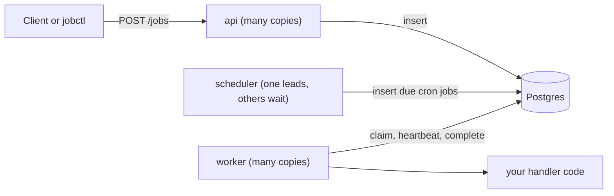

# The whole project, from scratch

This document assumes **no background**. If you can read a little code and know what a website is, you can follow it. It explains what problem this project solves, then rebuilds the solution one problem at a time, the way you would if you were inventing it. By the end you should be able to explain every part of the repository to someone else.

It is the *story*. The other documents are the *reference*:

| Document | Purpose |
|---|---|
| **This file** | Learn the whole thing from zero, in order |
| [GUIDE.md](GUIDE.md) | Go deeper on each idea, tour the code, interview questions and a demo script |
| [DESIGN.md](DESIGN.md) | Architecture decisions and tradeoffs |
| [OPERATIONS.md](OPERATIONS.md) | Configure, size, scale and run it |
| [SLO.md](SLO.md), [runbooks/](runbooks/README.md) | Reliability targets and what to do when an alert fires |

Contents

1. [The problem, in everyday words](#1-the-problem-in-everyday-words)
2. [Seven words you need first](#2-seven-words-you-need-first)
3. [Building it up, one problem at a time](#3-building-it-up-one-problem-at-a-time)
4. [The parts, and what runs where](#4-the-parts-and-what-runs-where)
5. [One job, followed end to end](#5-one-job-followed-end-to-end)
6. [Scheduled (cron) jobs](#6-scheduled-cron-jobs)
7. [Many customers on one system](#7-many-customers-on-one-system)
8. [Seeing inside it](#8-seeing-inside-it)
9. [Packaging and shipping it](#9-packaging-and-shipping-it)
10. [How we know it works](#10-how-we-know-it-works)
11. [A map of the repository](#11-a-map-of-the-repository)
12. [Run it yourself](#12-run-it-yourself)
13. [What it does not do, and what could come next](#13-what-it-does-not-do-and-what-could-come-next)

---

## 1. The problem, in everyday words

Imagine a restaurant. A waiter takes your order and, instead of cooking it, clips a ticket to a rail. Cooks take tickets from the rail and cook. The waiter is free to serve the next table immediately.

Software has the same shape. A website receives a request such as "sign me up". Some of the work is quick (save the account) and some is slow or can fail (send a welcome email, resize the avatar, call a partner's API, build a monthly report). If the web server did the slow work itself, the user would wait, and if the server crashed halfway the work would simply vanish.

So we split it up:

- The website **writes a ticket** (a *job*) describing the work and replies "got it" straight away.
- Separate programs called **workers** take tickets and do the work, whenever they have capacity.
- The rail that holds the tickets is a **job queue**.

A system like this has to answer hard questions, and answering them *correctly* is what this project is about:

| Question | Why it is hard |
|---|---|
| What if two cooks grab the same ticket? | You send the customer two emails, or charge them twice. |
| What if a cook faints halfway through? | The ticket is "taken" but nobody is cooking it. It must come back. |
| What if the dish fails (the partner API is down)? | Retry, but not instantly and not forever, and not all at once. |
| What if we want something every night at 2am? | We need a clock that fires tickets, and never fires one twice. |
| What if one customer files a million tickets? | Everyone else's food goes cold. |
| How do we *know* it is working? | A queue that silently stalls is worse than one that crashes. |

This project is a complete, tested answer to those questions: a **distributed job scheduler**. "Distributed" means many machines cooperate, so any one of them can die without the system losing work.

**What you get, in one paragraph.** Clients send jobs over HTTP (run now, run in 10 minutes, or run on a cron schedule). Jobs are stored in **Postgres**, a database, so they survive any crash. A fleet of workers running on many machines claims jobs and runs your code. A dead worker's jobs are noticed and given to someone else. Failed jobs are retried with growing delays, and the ones that never succeed land in a "dead" pile you can inspect and replay. The whole thing ships as containers, deploys to Kubernetes, and exposes metrics, logs and traces so you can see inside it.

---

## 2. Seven words you need first

You can skip any you already know.

**Process.** A running program. A "worker" is a process. Many workers means many copies of that program running at once, usually on different machines.

**Database and Postgres.** A database stores data durably on disk: if the computer loses power, committed data is still there afterwards. Postgres is a very widely used one. It stores data in **tables** (like spreadsheets). Each row is one record. Here, each job is one row in a table called `jobs`.

**Transaction.** A group of database changes that happen **all together or not at all**, and that other people cannot see half-done. "Take money out of A and put it in B" must be one transaction. Once a transaction is **committed**, it is durable. Committing is relatively slow because the database waits for the disk, and this will matter later.

**Lock.** A way to say "I am working on this row, wait your turn". Locks prevent two programs changing the same thing at the same moment. They also cause waiting, which is the enemy of speed. A lot of this project is about getting the safety of locks without the waiting.

**API.** A program that other programs talk to over the network. Ours speaks **HTTP** (the same protocol as websites): you `POST /jobs` with a description of the work and it replies with an id.

**Container and Docker.** A container is a program packaged together with everything it needs, so it runs identically on any machine. Docker builds and runs containers. An **image** is the packaged, frozen form; a container is a running copy.

**Kubernetes.** A system that runs many containers across many machines. You tell it "I want 5 copies of the worker" and it starts them, restarts any that die, and can add or remove copies as load changes. A **pod** is Kubernetes's word for one running container (roughly).

---

## 3. Building it up, one problem at a time

The best way to understand a design is to see why each piece exists. So let us build the queue starting from the simplest possible version and fix what breaks. Each step names the idea and where it lives in the code.

### Step 0: the naive version

A table of jobs. Workers loop forever doing:

```sql
SELECT * FROM jobs WHERE status = 'pending' LIMIT 1;     -- look at the rail
UPDATE jobs SET status = 'running' WHERE id = <that id>;  -- take the ticket
-- do the work
UPDATE jobs SET status = 'done' WHERE id = <that id>;
```

This works with one worker and is wrong with two. Everything below is a fix for something that goes wrong.

### Problem 1: two workers take the same job

Worker A and worker B both run the `SELECT` before either runs the `UPDATE`. Both see job 7. Both run it.

**Fix: claim in one statement, and skip rows someone else holds.** Postgres has `FOR UPDATE SKIP LOCKED`. "Lock the rows I pick; if another worker already locked a row, *skip it* instead of waiting." Selecting the rows and marking them `running` happen in the same statement, so there is no gap.

```sql
WITH picked AS (
    SELECT id FROM jobs
    WHERE status IN ('pending','retrying') AND run_at <= now()
    ORDER BY priority DESC, run_at, id
    LIMIT 10
    FOR UPDATE SKIP LOCKED
)
UPDATE jobs SET status = 'running', ... FROM picked WHERE jobs.id = picked.id
RETURNING ...;
```

Without `SKIP LOCKED`, fifty workers would queue up behind the same first row. With it, each simply gets the next free rows, so they do not slow each other down. `LIMIT 10` claims ten at once to cut down on round trips.
*Code: `claimSQL` in [internal/queue/store.go](../internal/queue/store.go).*

### Problem 2: a worker dies holding a job

The job says `running` forever and nobody is running it. Nobody tells the database that a crashed worker crashed.

**Fix: a lease and a heartbeat.** Claiming a job does not give it to you forever, it *rents* it for 30 seconds (`locked_until = now() + 30s`). While your code runs, a background loop called the **heartbeat** renews the rental every 10 seconds. If the worker dies, the renewals stop, the rental runs out, and a **reaper** puts the job back in the queue for someone else.

Recovery time after a crash is therefore about the lease length plus the reaper's interval, roughly 30 to 40 seconds. That is a tradeoff you can tune: a shorter lease recovers faster but sends more heartbeat traffic and is more likely to wrongly steal a job from a worker that is merely slow.
*Code: `heartbeat` in [internal/worker/worker.go](../internal/worker/worker.go), `Reap` in store.go.*

### Problem 3: the "zombie" worker

The worker did not die, it just froze for 40 seconds (a pause for memory clean-up, a frozen virtual machine). Its lease ran out, the job went to worker B, and B finished it. Then worker A wakes up and writes "I'm done!" over B's result.

**Fix: a fencing token.** Every claim adds 1 to a counter, `attempts`. Every write that finishes a job must say "I am worker A and this is attempt 1", and the database only accepts it if that is **still true**:

```sql
UPDATE jobs SET status = 'succeeded'
WHERE id = $1 AND status = 'running' AND locked_by = $2 AND attempts = $3;
```

Worker A holds attempt 1. The job is now on attempt 2 under worker B, so A's update matches **zero rows** and is rejected. The worker treats "zero rows" as "I lost the lease" and throws its result away. The name comes from a similar idea in distributed locking.
*Code: `fenced` in store.go; test `TestStaleWorkerCannotWriteAfterReclaim`.*

### Problem 4: "exactly once" is impossible, so say so

The fence stops a zombie from corrupting the *record*. It cannot stop the zombie from having already *sent the email*. And if a worker sends the email and crashes one instant before writing "done", no system anywhere can know whether the email went out. This is a fundamental limit, not a bug in this project.

So the honest promise is **at-least-once**: every job runs one or more times, never zero. The way to live with that is for your job code to be **idempotent**, meaning running it twice has the same effect as once. Techniques: pass the job's id to the email provider as a de-duplication key, write `status = 'shipped'` rather than `count = count + 1`, or record "done" in the same transaction as the side effect.

> Volunteer this first when you explain the project. It is the single most credible thing you can say about a queue.

### Problem 5: failures should be retried, sensibly

A handler returns an error. What now?

- **Permanent error** (the payload is garbage, the job type does not exist): mark `failed`, do not retry.
- **Out of attempts** (default 5): mark `dead`. This is the **dead-letter queue (DLQ)**: a place to inspect failures, fix the bug, and **replay** the job with a fresh budget.
- **Otherwise**: mark `retrying` and try again after a delay.

The delay is **exponential backoff with jitter**: roughly 5 s, 10 s, 20 s, 40 s, ... capped at an hour, with half of each delay randomised. Exponential growth gives a struggling service room to recover. The randomness matters more than it looks: if 10,000 jobs fail together during an outage and all retry at exactly the same instant, they knock the service over again (a "thundering herd"). We use *equal* jitter (`delay/2 + random(0, delay/2)`) so a retry can never fire almost immediately.

One detail: `attempts` is counted when the job is **claimed**, not when it fails. A "poison" job that crashes the whole process (say, it runs out of memory) never gets to report a failure, but it still used up an attempt, so it eventually ends in `dead` instead of crash-looping forever.
*Code: [internal/job/backoff.go](../internal/job/backoff.go), `finalize` in worker.go.*

### Problem 6: a deploy should not kill running jobs

When you release a new version, the old workers are told to stop with a polite signal (`SIGTERM`). A naive worker exits immediately, abandoning whatever it was doing.

**Fix: graceful shutdown.** On `SIGTERM` the worker (1) stops claiming new jobs, (2) lets running jobs finish for up to a grace period, and (3) if some are still running when the grace ends, cancels them and **releases them back to the queue without using up an attempt**, because being interrupted by a deploy is not the job's fault.

Kubernetes has its own timer: if the pod has not exited after `terminationGracePeriodSeconds`, it kills it with no mercy. So the chart computes that timer from the longest job timeout plus a margin, so the two never disagree. A test checks this for several values.

### Problem 7: clocks disagree

Different computers' clocks differ by milliseconds to seconds. If worker A's clock runs 5 seconds fast, it would think other workers' leases had expired and steal their jobs.

**Fix: only ever use the database's clock.** Every "is this time in the past?" question is answered inside SQL with `now()`. One shared clock, so the whole class of bug disappears.

### Problem 7b: one commit per finished job is slow at scale

Every job ends with a *durable commit* (the database waits for the disk). One database commits for all the workers, so beyond a point, adding workers only makes them queue for commits: throughput stopped growing around 4 workers in our tests (and in one run fell).

**Fix: group commit.** Instead of writing each result on its own, a worker collects the results of jobs that finish around the same time and writes them in **one** statement and **one** commit. There is no timer: the writer saves whatever has piled up while its previous write was running, so a quiet worker adds no delay and a busy one batches automatically. The fencing check from Problem 3 still applies to every row, so one worker's lost lease affects only that job.

**What happened when we measured it:** commits per job fell about 3.5 times. Throughput rose 51% at 8 workers (3,997 to 6,054 jobs a second) but showed no gain at 1 to 4 workers. An earlier version that waited a fixed 5 milliseconds to fill batches was actually *slower* at 1 to 2 workers, so we removed the wait. It is switched off by default and you turn it on when you run many workers on one database.

### Problem 8: running things on a schedule

"Every night at 2am" needs something that watches the clock and creates jobs. Section 6 covers it.

### Problem 9: one customer floods the queue

Section 7 covers fairness, rate limits and backpressure.

### Problem 10: we cannot see what is happening

Section 8 covers metrics, logs, traces, dashboards and alerts.

### Problem 11: it has to run somewhere

Section 9 covers containers, Kubernetes, autoscaling, GitOps and CI.

### Why Postgres, and not a purpose-built queue like Kafka or Redis?

This is the question you will be asked. The honest answer:

| Postgres gives you | Cost |
|---|---|
| Durable, transactional storage you almost certainly already run | One primary database is the throughput ceiling (about a thousand jobs a second per machine in our tests, see section 10) |
| You can enqueue a job in the **same transaction** as your business data, so "create the order and queue its email" is all-or-nothing | Needs care to keep the hot table small and well indexed |
| `SKIP LOCKED` makes it a genuinely good queue | Not built for millions of jobs a second |
| One system to run, back up and reason about | Scaling past one primary means sharding queues across databases |

For the large majority of applications that ceiling is far away, and the simplicity is worth it. Knowing exactly where the ceiling is and what you would do next (section 13) is the point.

---

## 4. The parts, and what runs where

There are four programs (the `cmd/` folder), and one database.



| Program | Job | Scale it? |
|---|---|---|
| **api** | Receives `POST /jobs` and friends, checks the API key, validates, writes to Postgres. Holds no state of its own. | Yes: more copies behind a load balancer |
| **worker** | Claims jobs, runs handlers, heartbeats, records results, and also runs the reaper and the retention cleanup. | Yes: more copies = more throughput (until Postgres commit rate becomes the limit) |
| **scheduler** | Turns cron schedules into job rows at the right moments. | Run 2 or more for safety. Only one is active at a time (and even if two were, nothing breaks, see section 6) |
| **jobctl** | A command-line tool: submit jobs, look them up, manage schedules, create API keys, run migrations, set limits. | n/a |

Key point: **Postgres is the only thing that holds state and the only thing the programs use to coordinate.** There is no message broker, no shared memory between workers, no leader you have to keep alive. That is why any process can be killed at any time.

### "Your handlers"

A handler is a Go function `func(ctx, job) error` registered under a name (the job `type`). When a job with type `send_email` is claimed, the worker looks up `send_email` in its registry and calls it. The `ctx` carries a deadline and is cancelled on timeout or shutdown, and good handlers watch it. Five demo handlers ship in [internal/handlers](../internal/handlers/builtin.go): `noop`, `sleep`, `fail`, `flaky` (fails until a chosen attempt), and `log`.

---

## 5. One job, followed end to end

Here is a real sequence. A client submits a job whose handler is `flaky`, set to fail twice and succeed on the third attempt. Times are illustrative.

```
t=0.0s   Client:  POST /jobs {"type":"flaky","payload":{"succeed_on_attempt":3}}
                  API checks the key, finds tenant "demo", INSERTs a row.
                  Reply: 201 {"id":"3f2a..."}   <- from here, the job cannot be lost

         row: status=pending  attempts=0  run_at=0.0s

t=0.8s   Worker 2 polls, runs the claim statement.
         row: status=running  attempts=1  locked_by=worker-2  locked_until=t+30s
t=0.8s   Handler runs, returns an error.
         Worker 2 records it (fenced: id, worker-2, attempts=1 all still match).
         row: status=retrying attempts=1  run_at=t+~4s (5s backoff, jittered)  last_error=...

t=5.1s   Worker 1 claims it (any worker may).
         row: status=running  attempts=2  locked_by=worker-1
         Handler fails again.
         row: status=retrying attempts=2  run_at=t+~8s (10s backoff, jittered)

t=14s    Worker 3 claims it.  attempts=3 -> the handler succeeds.
         row: status=succeeded  attempts=3  finished_at=...
```

Now the same job, but with a crash at the moment marked `*`:

```
t=0.8s   Worker 2 claims it. attempts=1, lease until t=30.8s
t=3.0s * Worker 2 is SIGKILLed. Nothing is written. The row still says "running".
         ... heartbeats have stopped ...
t=31s    The lease has expired. Another worker's reaper runs:
         row: status=retrying  (attempts=1, so 4 left)  locked_by=NULL
t=32s    Worker 1 claims it: attempts=2. Runs it. Succeeds.
```

Two things to notice. The job ran *twice* from the outside world's point of view if worker 2 had got partway through before dying, which is exactly why handlers must be idempotent. And nothing was lost, because the only state that mattered was in Postgres.

You can watch this happen yourself in the demo (section 12).

### The states

| State | Meaning |
|---|---|
| `pending` | Waiting for its `run_at` time. A "delayed job" is just `pending` with a `run_at` in the future. |
| `running` | A worker holds it under a lease. |
| `succeeded` | Done. A cleanup task deletes old ones after a retention period (default 7 days). |
| `retrying` | An attempt failed; waiting out the backoff delay. |
| `dead` | Ran out of attempts. The dead-letter queue. Can be replayed. |
| `failed` | Permanent error. Not retried. Can be replayed. |

The database itself enforces a rule that is easy to miss: a `CHECK` constraint says a job is `running` **if and only if** it has a lease owner and a lease deadline. A bug that tried to create a "running job with no owner" would be rejected by Postgres itself.
*Schema: [migrations/000001_create_jobs.up.sql](../migrations/000001_create_jobs.up.sql). State machine: [internal/job/job.go](../internal/job/job.go).*

### Indexes, briefly

An **index** is a sorted lookup structure that lets the database find rows without reading the whole table. The claim query is the hottest query in the system, so it has a **partial index** that includes only `pending` and `retrying` rows. However many millions of finished jobs pile up, that index stays small, and claiming stays fast. There are similar small indexes for the reaper and the cleanup task.

---

## 6. Scheduled (cron) jobs

A **schedule** is a row holding a cron expression (like `0 9 * * *`, "every day at 9:00"), a timezone, a job template, and the time of its next firing (`next_fire_at`). The scheduler program repeatedly asks "which schedules are due?" and inserts a normal job row for each, then moves `next_fire_at` forward. Workers do the rest exactly as for any job.

Three details make it production-grade rather than a toy:

**Timezones.** `0 9 * * *` in `America/New_York` means 9am New York time on both sides of a daylight-saving change, so the UTC time shifts by an hour twice a year. Tests cover the spring-forward and fall-back dates. The timezone database is compiled into the binary because the minimal container image has none.

**Missed firings.** If the scheduler was down for three hours, what should an hourly job do? You choose a *misfire policy*:

| Policy | Behaviour | Good for |
|---|---|---|
| `fire_once` (default) | Run once for the most recent missed slot, then carry on | Most things: catch up without a flood |
| `skip` | Run only if the latest slot is still recent, otherwise wait for the next | Jobs that are useless when late |
| `fire_all` | Run once for every missed slot (bounded per tick) | Jobs where every slot matters, such as hourly billing |

The decision is a pure function ([`Plan` in cron.go](../internal/scheduler/cron.go)) with no database or clock inside, so it is easy to test exhaustively.

**Never fire twice.** Two independent safeguards:

1. *Row locks.* The scheduler locks due schedules with `FOR UPDATE SKIP LOCKED` and, **in one transaction**, inserts the jobs and advances `next_fire_at`. Two schedulers cannot both process the same schedule.
2. *A unique key per slot.* Every cron-created job carries the key `cron:<schedule>:<slot time>`, and the database refuses two jobs with the same key for one tenant. Even if safeguard 1 were bypassed, the second insert fails.

On top of those sits **leader election** (a Postgres *advisory lock*: only one scheduler holds it at a time, the others wait). It exists so standby schedulers do not do pointless work. It is deliberately **not** what keeps you safe, and that is the interesting part. When a leader dies, Postgres frees the lock at once and a standby takes over, but the old leader may take about a second to notice it lost, so briefly two believe they lead. Rather than pretend otherwise, the system is built so that this overlap is harmless, and a test runs six schedulers with election **switched off** and still gets exactly one job per slot.

---

## 7. Many customers on one system

**Multi-tenancy** means several independent customers (tenants) share one deployment and must not see or harm each other.

**Identity.** Each tenant has API keys. A key is 256 random bits, shown once at creation, and only its **SHA-256 hash** is stored, so even someone who reads the database cannot recover a key. (A deliberately slow hash like bcrypt protects *guessable* passwords; this key is not guessable, so a slow hash would only add latency.) The tenant always comes **from the key**, never from the request body, so a client cannot claim to be someone else. Asking for another tenant's job returns **404, not 403**, so job ids cannot be probed. Idempotency keys are unique per tenant.

**Idempotent submit.** A client sends `idempotency_key: "order-123-email"`. If the network drops the reply and the client retries, the second request returns the **same job** (HTTP 200 instead of 201) instead of creating a duplicate. Fifty concurrent submits with one key create one job; there is a test for exactly that.

**Fairness.** Without protection, one tenant who submits a million jobs makes everyone wait. Three optional limits per queue and tenant, set with `jobctl limits`:

| Limit | What it does | Protects |
|---|---|---|
| `max_running` | At most N of this tenant's jobs run at once | Shared workers |
| `rate_per_second` and `burst` | A **token bucket**: tokens refill steadily up to a ceiling, each job started spends one | A partner API that allows "10 requests a second" |
| `max_backlog` | When too many jobs are waiting, the API answers **HTTP 429 Too Many Requests** with `Retry-After` | The database and the producer: slow down instead of growing forever |

The interesting engineering is making the cap **exact**. "Count what is running, then start `cap − running` more" has a race: two workers both count 4 with a cap of 5, both start one, and now 6 run. The fix is to lock the rule's row for the length of a short claim transaction, so counting and claiming are atomic. A test with 16 concurrent claimers never exceeds a cap of 5, and, importantly, when I deliberately removed the lock the test failed (10 claimed against a cap of 5), proving the test really detects the bug it exists for.
*Code: [internal/queue/limits.go](../internal/queue/limits.go).*

---

## 8. Seeing inside it

A system you cannot observe is a system you cannot trust. There are three kinds of signal, plus the things built on them.

**Metrics** are numbers over time, collected by **Prometheus** from a `/metrics` endpoint on each program. The most useful single one is `oldest_ready_job_age_seconds`: *how long has the longest-waiting runnable job waited?* If it is climbing, workers are not keeping up, whatever else the system claims. Others: jobs by status, the delay between submit and start (pickup latency), how long handlers take, retries, size of the dead-letter queue, and how many jobs were recovered from dead workers.

**Logs** are written as JSON lines (`log/slog`), each tagged with `job_id`, `tenant_id`, `worker_id` and `trace_id`, and collected by **Promtail** into **Loki** so you can search them in one place.

**Traces** follow one request through several programs. The API stores the incoming trace identifier (the W3C `traceparent`) inside the job's row. Much later, on a different machine, the worker reads it back and continues the *same* trace. One picture then shows submit, enqueue, claim, execute and complete, even though no memory was shared. Collected by **OpenTelemetry** into **Tempo**.

**Grafana** shows all three. Its dashboard (28 panels) is *generated by a Python script* (`deploy/grafana/gen/gen_dashboard.py`), not hand-drawn, so it is reviewable and reproducible.

**Alerts** are rules evaluated by Prometheus and routed by **Alertmanager**. Every alert links to a **runbook** (what it means, how to check, how to fix) in [docs/runbooks/](runbooks/README.md).

**SLOs** (service level objectives) turn "is it good?" into a number. For example, "99% of jobs start within 30 seconds of being due". The alerts use **multi-window burn-rate** logic: page a human only when the error budget is being consumed fast over *both* a long and a short window, so a brief blip does not wake anyone but a real outage does. Explained in [SLO.md](SLO.md).

A small lesson learned the hard way: counters whose labels are known in advance are created **at zero on startup**. Prometheus cannot see the jump from "no series" to "1", so without this the first crash recovery on each worker was invisible, and an alert that depended on it would have missed it. A screenshot where a panel was flat while the logs said otherwise exposed this; there is now a regression test.

---

## 9. Packaging and shipping it

Writing code that works on your laptop is half the job. The other half is making it run the same way everywhere, automatically, safely.

**Docker images.** Each program becomes a small image ([deploy/docker/Dockerfile](../deploy/docker/Dockerfile)): a multi-stage build compiles the Go binary, then copies only that binary into a "distroless" base with no shell and no package manager, running as a non-root user. The images are 22 to 35 MB and a scanner (**Trivy**) finds no fixable serious vulnerabilities in them.

**Docker Compose** starts the *whole* stack on one machine with `make up`: Postgres, the four programs, Prometheus, Alertmanager, Grafana, Loki, Promtail and Tempo. This is what you use for development and demos.

**Kubernetes and Helm.** The [Helm chart](../deploy/helm/jobscheduler) is a template that produces all the Kubernetes objects. Highlights, each of which exists for a reason covered earlier:

- Pods run as non-root with a read-only filesystem and dropped privileges.
- *Liveness* probes never touch the database (otherwise a database blip would make Kubernetes restart every pod and make things worse), while *readiness* probes do (so a pod that cannot reach the database stops receiving traffic).
- The shutdown grace period is derived from the longest job timeout (Problem 6).
- The database migration runs as a one-off job before the app starts.
- **PodDisruptionBudgets** ensure that draining a node never takes all copies of a component down at once.
- **NetworkPolicies** deny all traffic by default and allow only the connections that are needed.
- The API scales on CPU (**HPA**). Workers scale on the **queue backlog** using **KEDA**, because CPU is a poor signal for a queue (idle workers and a huge backlog can exist at the same time). Scale-down is deliberately slow because each removed pod must drain its jobs.

**GitOps with Argo CD.** Instead of someone running `helm upgrade` by hand, Argo CD watches a git repository and makes the cluster match it. A deploy is a git commit; a rollback is `git revert`; manual changes made directly to the cluster are detected and undone ("self-heal").

**CI/CD with GitHub Actions** ([.github/workflows/ci.yml](../.github/workflows/ci.yml)) runs on every change:

```
lint (gofmt, vet, golangci-lint)  ->  all tests with the race detector  ->  chart checks
  ->  build the 4 images  ->  Trivy scan BEFORE pushing  ->  push to GitHub's registry
  ->  commit the new image tag into deploy/argocd/values-prod.yaml  ->  Argo CD rolls it out
```

Separate workflows run the Kubernetes verification (on a throwaway **kind** cluster, which is Kubernetes inside Docker), a nightly chaos test, and an on-demand load test. Dependabot opens weekly, grouped pull requests to keep dependencies fresh.

---

## 10. How we know it works

Claims are cheap. Every guarantee in this project has a test that tries to break it.

**Unit tests** cover the pure logic: the state machine, backoff maths, cron planning including daylight-saving dates, configuration.

**Integration tests** run against a real Postgres (started automatically in a container) because mocks cannot catch locking bugs. There are **220 tests, none skipped**. A past lesson: a test that cannot find a database *skips*, and a skipped test prints `ok`. So in CI, a missing database is made a hard failure.

**The scale test:** 50 workers, 100,000 jobs, with the race detector on. It asserts **zero duplicate executions and zero lost jobs**.

**The chaos test** runs the real binaries and `SIGKILL`s workers and schedulers at random while work flows, then checks the invariants. An actual run: 52 kills, 20,000 jobs, all 20,000 succeeded, 484 recovered after their worker died mid-job, and 46 cron slots fired with zero gaps and zero duplicates. There is also a version that kills containers, and one that crashes pods on Kubernetes.

**Kubernetes verification** (`make k8s-verify`, also run in CI) proves on a real cluster that KEDA scales workers up and down, crashes lose nothing, a rolling deploy lets running jobs finish, a job longer than the grace period is released rather than lost, and draining a node respects the disruption budgets.

**Performance** was measured, not guessed, on one ordinary machine (12 CPUs, Postgres with full durability on):

| Measurement | Result |
|---|---|
| Absorbing a burst | 60,000 jobs inserted at once, drained by 4 workers in 47 s |
| Submit latency | p95 of 12 to 17 ms from 100 to 500 requests/s, no failures |
| Throughput by worker count | 975 jobs/s with 1 worker, peaking at 3,319 with 4, then **falling**; with group commit on, 8 workers reach 6,054 versus 3,997 without |
| Crash resilience | 11 containers killed mid-run: 6,000 of 6,000 jobs completed |

Why does throughput fall past 4 workers? Every job costs one durable commit, and one Postgres commits for all of them; beyond the peak, extra workers only fight over it. Completion batching (Problem 7b) cut commits per job about 3.5 times and raised the 8-worker figure by half; it did not remove the ceiling. Those are **no-op** jobs, so this measures the queue's own overhead; real jobs spend their time doing real work, and then more workers help much more. Charts and raw data: the [main README](../README.md#performance) and [docs/perf](perf/README.md). All of it is reproducible by script, and nothing on a chart is typed in by hand.

The honest caveats are stated alongside the numbers too: results vary between runs on a shared machine, quantiles above the top histogram bucket are interpolated, and Prometheus cannot see a process that dies faster than its scrape interval.

---

## 11. A map of the repository

```
cmd/                    the four programs. Each main() is tiny: read config, wire things, handle signals
  api/  worker/  scheduler/  jobctl/
internal/               the real code (Go's "internal" means other projects cannot import it)
  job/                  the Job type, the state machine, backoff. Pure logic, no I/O. START HERE
  queue/                every SQL statement: enqueue, claim, heartbeat, fenced complete/fail, reaper, API keys, limits
  worker/               poll loop, handler registry, heartbeats, graceful shutdown
  scheduler/            cron parsing, misfire planning, the fire transaction, leader election
  api/                  HTTP handlers, authentication, validation
  metrics/ telemetry/   Prometheus metrics; OpenTelemetry tracing and logging setup
  config/ migrate/      environment-variable config; applying database migrations
  handlers/ testdb/     demo handlers; starts a throwaway Postgres for tests
migrations/             numbered SQL files, each with a tested "down" to undo it
deploy/                 everything to run it: docker/ helm/ argocd/ kind/ prometheus/ grafana/ loki/ tempo/ ...
test/                   integration/ (incl. the scale test), chaos/, load/ (k6), helm/ (chart render tests)
scripts/                smoke, chaos, perf measurement, charting, kind and Argo CD verification
docs/                   these documents, runbooks, perf data and images
.github/workflows/      CI, Kubernetes verification, nightly chaos, load test
```

Every folder has its own `README.md` explaining that part.

**A good reading order for the code**, with the time it takes:

1. [internal/job/job.go](../internal/job/job.go): the vocabulary (10 min)
2. [migrations/000001_create_jobs.up.sql](../migrations/000001_create_jobs.up.sql): the table and its constraints (10 min)
3. [internal/queue/store.go](../internal/queue/store.go): the heart; read it twice (45 min)
4. [internal/worker/worker.go](../internal/worker/worker.go): how a worker runs a job from claim to result (30 min)
5. [internal/scheduler/](../internal/scheduler/): cron, then the fire transaction, then election (30 min)
6. [internal/queue/limits.go](../internal/queue/limits.go) and [internal/api/api.go](../internal/api/api.go)
7. The tests, as a second telling of the same story. Start with [store_test.go](../internal/queue/store_test.go).

---

## 12. Run it yourself

You need Docker (with the buildx plugin) and Go. Everything below is from the [README](../README.md).

```bash
make up                                   # build the images and start the whole stack
export JOBCTL_API_KEY=$(make -s key)      # create an API key for tenant "demo"
make build                                # build ./bin/jobctl
export JOBCTL_URL=http://localhost:8080

# A job that fails twice and succeeds on the third try: watch the retries
./bin/jobctl submit -type flaky -payload '{"succeed_on_attempt":3}'
./bin/jobctl get -wait <job-id>

# A schedule in a timezone
./bin/jobctl schedule create -name hello -cron '*/5 * * * *' -tz America/New_York -type log -payload '{"hi":1}'

make smoke          # end-to-end check of the running stack
make chaos-docker   # kill containers at random; verify nothing is lost
make down           # remove everything
```

Open **Grafana** at <http://localhost:3000> (dashboard "Job Scheduler") and **Prometheus** at <http://localhost:9090> while you do it.

Other commands: `make test` (everything, includes the 100k-job test), `make test-short`, `make validate` (all static checks), `make kind-up` / `make k8s-verify` / `make argocd-verify` (Kubernetes on your machine), `make help` (the full list).

---

## 13. What it does not do, and what could come next

Know the limits before someone else points them out.

**Not done or not verified:**

- **Exactly-once.** Impossible in general. It is at-least-once, and handlers must be idempotent.
- **One database primary is the ceiling.** A few thousand jobs per second in our measurements, even with completion batching. Beyond that you shard queues across databases or move to a different design.
- **Not verified on managed cloud.** It was proven on a local multi-node Kubernetes cluster (kind), not on a managed cloud service with a real ingress, an external database or real secret management. Rolling out the *published* images through Argo CD is also not yet exercised end to end.
- **The API autoscaler** reads its metric correctly, but no test has pushed it over its target to watch it scale out.
- **One thing observed and not explained:** during the burst test, two workers claimed far more than the other two for the first ~30 seconds. The total is correct, but the cause is unknown.
- **Handlers are in-process Go functions**, not a separate language-agnostic worker protocol.

**Natural next steps:**

| Idea | What it buys |
|---|---|
| `LISTEN/NOTIFY` | Workers wake immediately instead of polling about once a second, cutting idle pickup latency |
| **Outbox pattern** | Reliably publish events to other systems in the same transaction as a state change |
| **Workflows (DAGs)** | "Run B and C after A, then D": the step towards a mini Temporal |
| **A Kubernetes operator** | Declare queues and limits as Kubernetes resources |
| Branch protection and a `v0.1.0` release | Make the repository safe to share and the pipeline mandatory |

---

### If you remember only this

1. Jobs live in **Postgres**, so nothing is lost when processes die.
2. Workers **claim** with `FOR UPDATE SKIP LOCKED`, so no two take the same job and none wait for each other.
3. A claim is a **lease** kept alive by a **heartbeat**; a **reaper** recovers expired leases; a **fencing token** stops zombies from writing stale results.
4. It is **at-least-once**, so handlers must be **idempotent**.
5. Retries use **exponential backoff with jitter**; hopeless jobs go to a **dead-letter queue** you can replay.
6. Cron never double-fires because of **row locks plus a unique per-slot key**; leader election is only an optimisation.
7. Everything is **measured and observable**, and every guarantee has a **test that tries to break it**.
