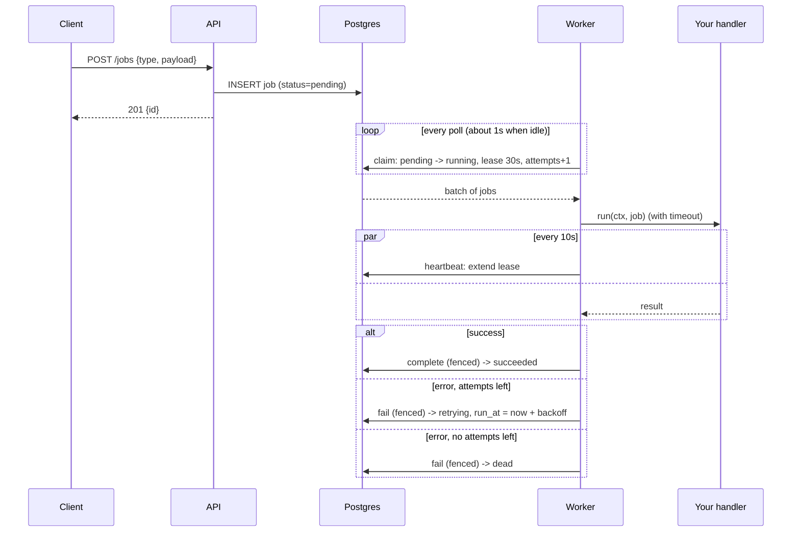

# Project Guide: understand it, demo it, defend it

This guide explains the system from the ground up. It is meant for the person who has to **explain every part of it in an interview**. The other documents are references ([DESIGN.md](DESIGN.md) for decisions, [OPERATIONS.md](OPERATIONS.md) for running it). This one is the explanation.

Read it in order once, then use sections 7 to 9 for interview preparation.

---

## 1. What this is, in plain words

You have work that should happen later, or somewhere else, or repeatedly: send an email, resize an image, generate a report every night at 2am. You do not want the web request to wait for it, and you do not want it lost if a server dies.

This project is the machinery for that:

1. A client says "run this job" (now, in 10 minutes, or every night) through an HTTP API.
2. The job is written to **Postgres**, so it survives any crash.
3. A fleet of **worker** processes on many machines repeatedly grab jobs and run your code.
4. If a worker dies mid-job, the job is noticed and given to someone else.
5. If a job fails, it is retried with growing delays; if it keeps failing it lands in a "dead" pile you can inspect and replay.

**The 30-second pitch:** "It's a Postgres-backed job queue and cron scheduler in Go. Workers claim jobs with `SELECT ... FOR UPDATE SKIP LOCKED`, hold a lease that a heartbeat keeps alive, and write results with a fencing token so a worker that lost its lease can't corrupt anything. I proved it with a test running 50 workers over 100,000 jobs with zero duplicates and zero losses, and with a chaos test that SIGKILLs workers and schedulers mid-run."

**The guarantees**, and the one honest caveat:

| Guarantee | Meaning |
|---|---|
| At-least-once execution | Every submitted job runs at least once, eventually |
| No job lost | Once the API says `201`, the job is in Postgres and will be run or end in `dead`/`failed` |
| No concurrent execution | Two workers never *hold* the same job at the same time |
| Crash recovery | A dead worker's jobs are re-queued automatically |
| Graceful shutdown | A deploy does not kill jobs mid-run |

**The caveat you must volunteer:** it is *at-least-once*, not *exactly-once*. After a crash a job can run twice, so **handlers must be idempotent**. Saying this first, before an interviewer asks, is a strong signal. Section 3.4 explains why exactly-once is not achievable here.

---

## 2. The life of a job



### The states

```
            +---------+  claim   +---------+  ok   +-----------+
 POST /jobs |         | -------> |         | ----> | succeeded |
 ---------> | pending |          | running |       +-----------+
            |         |          |         | error, retries left   +----------+
            +---------+          |         | --------------------> | retrying | --claim--> running
                  ^              |         |                       +----------+
                  |              |         | error, none left  +------+
                  | replay       |         | ----------------> | dead |  (the dead-letter queue)
                  +--------------+---------+                   +------+
                  | replay       | permanent error             +--------+
                  +--------------+---------------------------> | failed |
                                                               +--------+
```

| State | In words |
|---|---|
| `pending` | Waiting for its `run_at` time. A "delayed job" is just `pending` with a future `run_at`. |
| `running` | A worker holds it under a **lease** (a deadline). |
| `succeeded` | Done. Deleted later by the retention sweeper (default 7 days). |
| `retrying` | An attempt failed; waiting for the backoff delay. Claimable once `run_at` passes. |
| `dead` | Retries exhausted. This is the dead-letter queue (DLQ). Replayable. |
| `failed` | The handler said the error is **permanent** (e.g. bad payload) or the job type is unknown. Not retried. Replayable. |

`pending` and `retrying` are both "waiting to run". They are separate only so dashboards can tell fresh work from work that already failed once.

### Where each step lives in the code

| Step | Code |
|---|---|
| Submit, validate, auth | [internal/api/api.go](../internal/api/api.go) `submit` |
| Insert, idempotency | [internal/queue/store.go](../internal/queue/store.go) `Enqueue` |
| Claim | `claimSQL` and `Claim` in the same file |
| Poll loop and slots | [internal/worker/worker.go](../internal/worker/worker.go) `pollLoop` |
| Run handler, timeout, panic recovery | `execute`, `invoke` |
| Heartbeat | `heartbeat` |
| Decide the outcome | `finalize` |
| Backoff math | [internal/job/backoff.go](../internal/job/backoff.go) |
| Recover crashed jobs | `Reap` in store.go, driven by `maintenance` in worker.go |

---

## 3. The ideas, from first principles

Each subsection is "the problem, the solution, why it is correct, the tradeoff".

### 3.1 Claiming jobs without two workers taking the same one

**Problem.** Fifty workers all ask "give me a job". A naive `SELECT` then `UPDATE` lets two of them read the same row before either updates it.

**Solution.** One statement ([`claimSQL`](../internal/queue/store.go)):

```sql
WITH picked AS (
    SELECT id FROM jobs
    WHERE queue = $1 AND status IN ('pending','retrying') AND run_at <= now()
    ORDER BY priority DESC, run_at, id
    LIMIT $2
    FOR UPDATE SKIP LOCKED
)
UPDATE jobs j SET status='running', locked_by=$3,
       locked_until = now() + lease, attempts = attempts + 1
FROM picked WHERE j.id = picked.id
RETURNING ...
```

Read it line by line:

- `FOR UPDATE` locks the chosen rows so nobody else can modify them.
- `SKIP LOCKED` says: *if a row is already locked by someone else, skip it instead of waiting.* Without it, 50 workers would queue up behind the same first row. With it, each worker simply gets the next free rows. This is the entire trick.
- `LIMIT $2` is the batch size: one round trip claims many jobs.
- `ORDER BY priority DESC, run_at, id` matches the index `jobs_claim_idx`, so Postgres walks the index and stops after `LIMIT` rows. It does not sort the table.
- The `UPDATE` marks them `running`, stamps the lease and increments `attempts`, **in the same statement** as the selection. There is no gap for a race.
- `now()` is the database's clock (see 3.7).

**The key subtlety interviewers probe:** the row lock only lasts for this one statement. The *durable* claim is the `status='running'` plus the lease columns. So a job can run for an hour without holding a database transaction open, which matters because a long transaction pins a connection and blocks vacuum.

**Tradeoff.** The claim index is a single hot spot (all workers scan its head). Batching reduces round trips. At extreme scale you shard queues across databases.

### 3.2 Leases and heartbeats: how a dead worker's job comes back

**Problem.** If a worker crashes while holding a job, nobody tells the database. The job would stay `running` forever.

**Solution: a lease** (also called a *visibility timeout*). The claim sets `locked_until = now() + 30s`. While the handler runs, the worker's **heartbeat** goroutine extends it every `lease/3` (10s). If the worker dies, heartbeats stop, `locked_until` passes, and the **reaper** notices:

```sql
UPDATE jobs SET status = CASE WHEN attempts >= max_attempts THEN 'dead' ELSE 'retrying' END, ...
WHERE status='running' AND locked_until < now()   -- (with FOR UPDATE SKIP LOCKED)
```

Design details worth knowing:

- Why `lease/3`? So two heartbeats can be missed (a GC pause, a slow query) before the lease expires.
- The reaper runs inside **every** worker (every 10s). `SKIP LOCKED` makes concurrent reapers safe, so there is no singleton to elect.
- I used a **separate reaper** instead of adding `OR (status='running' AND locked_until < now())` to the claim query. The OR defeats the partial index and slows the hottest query. The price is up to one reaper interval of extra recovery delay.
- Recovery time after a crash is roughly `lease + reaper interval`, about 30 to 40 seconds by default. That is the lease tradeoff: shorter means faster recovery but more heartbeat traffic and more false reclaims under pauses.

### 3.3 Fencing: why a "zombie" worker cannot do damage

**Problem.** A worker is not dead, just paused for 40 seconds (a VM freeze, a long GC). Its lease expires, the job is re-queued and another worker finishes it. Then the paused worker wakes up and tries to write "done" or "failed". Without protection it could overwrite the real result.

**Solution: a fencing token.** Every claim bumps `attempts`. Every write that ends or extends a claim carries the worker's `(id, worker, attempts)` and is conditioned on them still matching ([`fenced`](../internal/queue/store.go)):

```sql
UPDATE jobs SET status='succeeded', ...
WHERE id=$1 AND status='running' AND locked_by=$2 AND attempts=$3
```

The zombie holds `attempts=1`; the job is now at `attempts=2` under a different worker, so the zombie's `UPDATE` matches **zero rows**. The code translates "zero rows" into `ErrLeaseLost`, and the worker discards its result. The same check on heartbeat makes the zombie cancel its running handler's context.

This is the same idea as a fencing token in distributed locking (Kleppmann's classic critique of naive Redis locks). Being able to name that comparison is worth a lot in an interview.

**Test that proves it:** `TestStaleWorkerCannotWriteAfterReclaim` in [store_test.go](../internal/queue/store_test.go).

### 3.4 Why it is at-least-once and not exactly-once

Fencing guarantees **one result is recorded**. It cannot stop a zombie's handler from having already *done something* (sent the email) before it learned it lost the lease. A side effect in the outside world cannot be un-run.

Exactly-once execution across a crash is impossible in general: if the worker dies *after* the side effect but *before* recording success, no system can tell whether the effect happened. The industry answer is **at-least-once delivery plus idempotent handlers** ("effectively once"). Practical idempotency tools:

- Use the job's `id` as an idempotency key with the downstream service (Stripe, an email provider, a database unique constraint).
- Make the operation naturally repeatable (`SET status = 'shipped'`, not `INCREMENT`).
- Record "done" in the same transaction as the side effect when the side effect is in the same database.

The scale test counts executions per job to show that without failures every job runs exactly once, and the chaos test shows that with failures a job only runs more than once if it was claimed more than once (`attempts`).

### 3.5 Retries and backoff

When a handler returns an error, the worker's [`finalize`](../internal/worker/worker.go) decides:

| Situation | Result |
|---|---|
| Error wrapped with `worker.Permanent(...)`, or unknown job type | `failed` (no retries) |
| `attempts >= max_attempts` | `dead` |
| Otherwise | `retrying`, with `run_at = now() + backoff` |

Backoff ([`job/backoff.go`](../internal/job/backoff.go)): `delay = min(cap, base * 2^(attempt-1))`, then **equal jitter**: `delay/2 + random(0, delay/2)`. Defaults: base 5s, cap 1h, 5 attempts.

- **Exponential** gives a struggling dependency room to recover.
- **Jitter** matters because without it, 10,000 jobs that failed together during an outage all retry at the same instant (a thundering herd) and knock the dependency down again.
- **Equal jitter** (rather than full jitter, `random(0, delay)`) keeps a floor of `delay/2`, so a retry cannot fire almost immediately.
- The random source is **injected**, so the math is deterministic in tests.

**`attempts` is counted at claim time, not failure time.** That is deliberate: a "poison pill" job that crashes the whole worker process (an out-of-memory kill) never gets to report a failure, but it still burned an attempt when it was claimed, so it ends in `dead` instead of crash-looping forever.

### 3.6 Graceful shutdown

On SIGTERM (what Kubernetes sends when it removes a pod), [`Worker.Run`](../internal/worker/worker.go):

1. **Stops claiming** new jobs.
2. Lets in-flight handlers keep running on a *separate* context (not cancelled by the signal) for up to `WORKER_SHUTDOWN_GRACE`.
3. If some are still running when the grace expires, **cancels** them with the cause `errShutdown`. They are **released** back to `pending` with their attempt refunded, because being interrupted by a deploy is not the job's fault.
4. A handler that ignores cancellation is abandoned after a few more seconds; its lease expires and the reaper recovers the job.

**The Kubernetes contract** ties it together: `terminationGracePeriodSeconds` must be longer than the drain time, or the kubelet will `SIGKILL` the worker mid-drain. The Helm chart derives all of it from one number: `worker.maxJobTimeoutSeconds` (the shutdown grace equals it, and the pod's grace period is that plus 15 seconds). A test asserts this for several values.

Two details that show care:

- The claim call itself is **not** cancelled by SIGTERM. The server may already have committed it; cancelling the client would strand those jobs until their leases expire.
- The result write (`complete`/`fail`) runs on a detached context with retries, so a handler that was cancelled by timeout can still record why.

### 3.7 Always use the database's clock

Every time comparison (`run_at <= now()`, `locked_until < now()`, lease extension, backoff, even "pickup latency") happens **in SQL using `now()`**, never with a worker's clock.

**Why.** Machines' clocks differ by milliseconds to seconds. If worker A's clock is 5 seconds fast it would think leases expired early and steal jobs. One shared time source removes the whole class of bug. Even `delay_seconds` on submit is sent as an interval and added to `now()` in SQL. (A client-supplied absolute `run_at` is the only place a client clock is used, and that is inherent.)

### 3.8 Cron scheduling and "never double-fires"

A **schedule** is a row with a cron expression, a timezone, a job template and a `next_fire_at`. The scheduler ([`internal/scheduler`](../internal/scheduler)) turns due schedules into job rows.

**Timezones.** The expression is evaluated on the wall clock of the schedule's zone, so `0 9 * * *` in `America/New_York` is 9am local on both sides of a daylight-saving change (tests cover the spring-forward and fall-back dates). Time zone data is embedded in the binary because distroless images have none.

**Misfire policies** decide what happens if the scheduler was down and slots were missed. `Plan` in [`cron.go`](../internal/scheduler/cron.go) is a pure function, table-tested:

| Policy | Behaviour | Use for |
|---|---|---|
| `fire_once` (default) | Run once for the most recent missed slot, then resume | Most jobs: catch up without a flood |
| `skip` | Run only if the latest slot is still fresh (within a grace window), else wait | Jobs that are useless when late |
| `fire_all` | Run once per missed slot (bounded per tick) | Jobs where every slot matters (hourly billing) |

**Two independent layers stop a double-fire:**

1. **Row locks.** `FireDue` locks due schedules with `FOR UPDATE SKIP LOCKED`, inserts the jobs and advances `next_fire_at` in **one transaction**. Two schedulers cannot process the same schedule at once.
2. **An idempotency key per slot.** Each fired job gets the key `cron:<schedule-id>:<slot-time>`, and `(tenant_id, idempotency_key)` is unique. Even if layer 1 were bypassed (an operator rewinding `next_fire_at`, a restored backup, a split brain), the second insert is rejected.

**Leader election** (a Postgres session advisory lock, [`election.go`](../internal/scheduler/election.go)) sits **on top** as an efficiency measure so standbys don't do pointless work. It is deliberately *not* the safety mechanism, and that is the most important thing to say about this component. Why it cannot be: when a leader's database session dies, Postgres frees the lock instantly and a standby takes over, but the old leader only notices on its next check (about a second). For that window two replicas believe they lead. I found this while writing the failover test; the correct response was to rely on layers 1 and 2, which still give one job per slot. A test runs **six schedulers with election disabled** and still gets exactly one job per slot.

The advisory lock is session-scoped, so it needs a dedicated connection and does not work through a transaction-mode PgBouncer.

### 3.9 Multi-tenancy and auth

- Each tenant has API keys. A key is 256 random bits shown once and stored as a **SHA-256 hash**. A slow hash like bcrypt would only add latency, because the key is already unguessable.
- The tenant **always comes from the key**, never from the request body. A `tenant_id` field in a request is an unknown field and gets a 400.
- Looking up another tenant's job returns **404, not 403**, so job IDs cannot be probed.
- Idempotency keys are unique **per tenant**, so one tenant cannot block or detect another's keys.

### 3.10 Observability

- **Metrics:** the most useful single one is `oldest_ready_job_age_seconds`: "how long has the longest-waiting runnable job waited?" Also queue depth by status, pickup latency histogram, handler duration by outcome, retries, DLQ size, reaped jobs (crash recoveries), scheduler leadership.
- **Logs:** JSON via `log/slog`; every job line has `job_id`, `tenant_id`, `worker_id`, `trace_id`.
- **Traces:** the API stores the W3C `traceparent` in the job row. The worker reads it back and continues the **same trace**, so one trace shows submit, enqueue, claim, execute and complete even though they ran in different processes at different times. A test asserts the parent/child chain.
- **SLOs and alerts:** [SLO.md](SLO.md) defines three SLOs and uses multi-window burn-rate alerts (page only when the error budget is burning fast over both a long and a short window, so you aren't paged for blips). Every alert links to a [runbook](runbooks/).

### 3.11 Fairness, rate limits and backpressure

**Problem.** One tenant submits a million jobs. Everyone else's jobs wait behind them; or the jobs call a partner API that allows 10 requests per second and you get banned; or the queue just grows until the database fills.

**Three limits** per `(queue, tenant)`, all optional ([limits.go](../internal/queue/limits.go)):

- **Concurrency cap** (`max_running`): at most N jobs of that tenant running at once.
- **Rate limit** (`rate_per_second`, `burst`): a **token bucket**. Tokens refill continuously up to `burst`; each claimed job spends one. Sustained rate is the refill rate, short bursts are allowed up to `burst`, and an idle tenant cannot bank unlimited credit.
- **Backpressure** (`max_backlog`): when too many jobs are waiting, the API answers **HTTP 429 with `Retry-After`**, so the producer slows down instead of the queue growing forever.

**The interesting part is making the cap exact.** "Count the running jobs, claim `cap - running`" has the classic race: two workers both count 4 with a cap of 5 and both claim, giving 6. The fix is to **lock the rule's row** (`SELECT ... FOR UPDATE SKIP LOCKED`) for the duration of a short claim transaction. Only one worker at a time can count-and-claim for a rule, so the check and the claim are atomic with respect to each other. `SKIP LOCKED` again means a worker that finds the rule busy simply moves on to other work. The token bucket is stored in the same row and refilled on the database clock, so it is exact for the same reason.

Tenants are split into disjoint groups (one per tenant with its own rule, one shared `*` group, one ungoverned group) so no job is unclaimable, and groups are visited in random order so none can monopolise a batch. The rule lookup is cached, so a queue with no rules runs the original single-statement claim.

**A subtle point for interviews:** a retried job takes a token again. That is deliberate. The limit exists to protect the thing the job calls, and a retry calls it again.

**Backpressure detail:** a retry of a submit the server already accepted (same `idempotency_key`) returns the existing job even while the queue is full. Otherwise a client that timed out and retried would be told "rejected" about a job that exists.

**How I know the tests are real:** I removed the row lock on purpose. The cap test then claimed 10 jobs against a cap of 5 and the rate test claimed 459 against a ceiling of 164, so the tests catch exactly the bug they exist for.

### 3.12 Autoscaling on queue depth

CPU is a poor signal for a queue worker (idle workers and a huge backlog can coexist). **KEDA** scales workers on the thing that matters: the runnable backlog, via a SQL query (`pending`/`retrying` with `run_at <= now()`, so delayed jobs don't trigger premature scale-up). Scale-down is deliberately slow because each removed pod must drain its jobs.

### 3.13 Completion batching (group commit)

**Problem.** Every job ends with a durable commit, and one Postgres commits for the whole fleet, so past a few workers more containers just contend (the measured peak was 4 workers, then a fall).

**Solution.** Workers hand their "succeeded" results to a per-worker flusher that writes everything accumulated in **one** statement, then immediately everything that piled up while that write was running (`CompleteBatch` in [store.go](../internal/queue/store.go), `completer` in [completer.go](../internal/worker/completer.go)). No timer: an idle worker adds no latency, and under load the batch grows to match the commit latency, the same idea as Postgres's own group commit.

**Why it is still correct.**

- The fence is the same, applied **per row**: `WHERE j.id = r.id AND status='running' AND locked_by = r.worker AND attempts = r.attempts`. A zombie's row simply does not match; only that job gets `ErrLeaseLost`.
- The job's goroutine blocks until its batch is committed, so its execution slot and lease are held until the result is durable. Shutdown draining and the reaper are unchanged.
- A statement-level error means nothing committed, so every waiter retries through the same retry loop as before.

**What I measured, including the part that did not work.** My first version waited a fixed 5 ms to fill batches. It cut commits per job from 1.0 to 0.25 and was *slower* at 1 and 2 workers, because every job kept its slot for the wait. Removing the timer fixed that. Final result: commits per job fall 3.1 to 3.6x everywhere; throughput rises 51% at 8 workers (3,997 to 6,054 jobs/s) and shows no gain beyond noise at 1 to 4. Throughput rose less than commits fell, so commit rate was a limit but not the only one. That is why it is opt-in (`WORKER_COMPLETE_BATCH`).

**The proof to point at.** `TestCompleteBatchIsFencedPerRow`, and the mutation check: deleting `AND j.attempts = r.attempts` makes it fail. Charts: [docs/perf](perf/README.md). Design: [DESIGN.md section 19](DESIGN.md#19-completion-batching-group-commit).

---

## 4. A guided tour of the code (read in this order)

1. [`internal/job/job.go`](../internal/job/job.go): the `Job` struct, the status state machine (`CanTransition`), the `Ref` fencing token. Pure, no I/O. 10 minutes.
2. [`migrations/000001_create_jobs.up.sql`](../migrations/000001_create_jobs.up.sql): the schema, the `lease_iff_running` CHECK constraint, the partial indexes.
3. [`internal/queue/store.go`](../internal/queue/store.go): every SQL statement. `claimSQL`, `fenced`, `Reap`, `Enqueue`. This is the heart; read it twice.
4. [`internal/worker/worker.go`](../internal/worker/worker.go): `Run` → `pollLoop` → `claim` → `execute` → `heartbeat` / `invoke` / `finalize`. Note the context juggling (`jobCtx` vs the signal `ctx`, `context.Cause`).
5. [`internal/queue/limits.go`](../internal/queue/limits.go) (limits: `claimLimited`, `Admit`), then [`internal/scheduler/cron.go`](../internal/scheduler/cron.go) `Plan`, then `store.go` `FireDue`, then `election.go`.
6. [`internal/api/api.go`](../internal/api/api.go): handlers, validation, auth middleware, tracing middleware.
7. [`cmd/*/main.go`](../cmd): how it all wires together; note how small they are.
8. Tests, as a second view of the same logic: [`store_test.go`](../internal/queue/store_test.go), [`worker_test.go`](../internal/worker/worker_test.go) (fake store, fast), [`scale_test.go`](../test/integration/scale_test.go) (the headline test), [`scheduler_test.go`](../internal/scheduler/scheduler_test.go).

**Coding patterns to be able to point at** (these are what "idiomatic Go" questions are about):

| Pattern | Where |
|---|---|
| Consumer-side small interfaces (the worker defines the `Store` it needs, so it is tested with a fake) | `worker.Store`, `api.JobStore` |
| Semaphore channel as a concurrency limiter | `pollLoop` (`sem chan struct{}`) |
| `context.WithCancelCause` / `WithTimeoutCause` to learn *why* a handler stopped | `execute`, `finalize` |
| `context.WithoutCancel` to finish work after the parent is cancelled | claim, finalize |
| Injected clock/RNG for deterministic tests | `job.Backoff.Rand` |
| Functional options | `worker.New(..., WithLogger(...))` |
| Errors wrapped with `%w`, sentinel errors checked with `errors.Is` | `queue.ErrLeaseLost` |
| No global state: each binary builds its own Prometheus registry | `metrics.New()` |
| Table-driven tests | `job_test.go`, `cron_test.go`, `worker_test.go` |

---

## 5. What happens when things go wrong

| Event | What happens | Why that is safe |
|---|---|---|
| **Worker is `kill -9`'d mid-job** | Heartbeats stop. After the lease expires, another worker's reaper re-queues the job; it runs again. | Lease + reaper. Attempt counted, so poison jobs terminate. |
| **Worker is partitioned from the DB, then reconnects** | Its lease expired and the job moved on. Its heartbeat gets `lease lost` and cancels the handler; its result write matches zero rows and is discarded. | Fencing token |
| **Handler panics** | Recovered, turned into an error, retried. The worker process survives. | `invoke` has `recover()` |
| **Handler hangs** | The per-job timeout cancels its context; the attempt fails and retries. (A handler that ignores `ctx` keeps its slot busy and can run twice after the lease expires; handlers must honour `ctx`.) | `WithTimeoutCause` |
| **Postgres goes down** | API returns 503; workers can't claim or record; handlers already running continue but their results may be lost to lease expiry. On recovery, expired leases are reclaimed and those jobs rerun. Nothing committed is lost. | Durable commits; idempotent handlers |
| **Scheduler leader dies** | A standby wins the lock within the retry interval (5s default); missed slots follow the misfire policy. | Persisted `next_fire_at` |
| **Two schedulers overlap** | Still one job per slot. | Row locks + idempotency key |
| **Client retries a submit** | Same job returned (`200` instead of `201`). | Unique `(tenant, idempotency_key)` |
| **Rolling deploy** | SIGTERM drains jobs; the API goes unready first so the load balancer drains it. | Shutdown contract (3.6) |
| **Worker clocks disagree** | No effect. | DB clock only |

---

## 6. The numbers (and how honest to be about them)

All measured on one WSL2 machine with 12 logical CPUs, Postgres 16 with durable settings (`fsync=on`), the load generator, API and workers all sharing that machine. Say that out loud when you quote them.

| Fact | Number | Source |
|---|---|---|
| Correctness at scale | 50 workers, 100,000 jobs: 0 duplicates, 0 lost, about 1,760 jobs/s even under the race detector | `TestFiftyWorkersHundredThousandJobs` |
| Chaos | 52 SIGKILLs, 20,000 jobs: all succeeded; 484 recovered after a mid-job kill; 46 cron slots with 0 gaps and 0 duplicates | `make chaos` |
| Throughput | 975 jobs/s with 1 worker, peaking at 3,319 with 4, then falling (medians of 3 runs): limited by Postgres commit rate (one durable completion write per job) | `scripts/perf-collect.sh` |
| Burst | 60,000 jobs inserted at once, drained by 4 workers in 47 s | same |
| Submit latency | p95 12 to 17 ms from 100 to 500 req/s with no failures (this run; an earlier run on a busier machine gave 71 ms at 400 req/s) | same |

**What the throughput number does and does not say.** These are *no-op* jobs, so it measures the queue's overhead, not your workload. Real jobs spend their time in handlers, and then worker count scales much better. The right way to say it: "the queue itself sustains on the order of a thousand jobs per second per worker container and a few thousand per Postgres primary on commodity hardware. Commit rate was the first limit, so I built group commit for completions: commits per job fell about 3.5x and 8-worker throughput rose 51%, from 3,997 to 6,054 jobs/s. At 1 to 4 workers there was no measurable gain, so it is opt-in. It did not remove the ceiling." See section 3.13.

---

## 7. Likely interview questions, with answers

### System design

**Q: Why Postgres instead of Redis, Kafka or SQS?**
Enqueue can be in the *same transaction* as the business write (the basis of the outbox pattern, which none of those can offer). It is durable by default, I can query and replay with SQL, and it is one less system to run. The cost is a throughput ceiling (one primary, commit-rate bound, vacuum pressure). For thousands of jobs per second that is fine; for hundreds of thousands I would move to a log like Kafka and give up queryable state.

**Q: Walk me through what happens when a worker crashes.**
Use the table in section 5 and name the pieces: lease, heartbeat, reaper, attempts counted at claim time. Then volunteer the consequence: the job may run twice, so handlers must be idempotent.

**Q: Can you guarantee exactly-once?**
No, and nobody can in general (section 3.4). I provide at-least-once and bound duplicates: fencing ensures only one *result* is recorded, and I tell users to make handlers idempotent using the job id as an idempotency key downstream.

**Q: What is a fencing token and why do you need it?**
A number that increases on each claim, checked on every write, so a worker that lost its lease cannot overwrite the new owner's result. Needed because a leased worker can't *know* its lease expired (a pause looks like nothing to the paused process).

**Q: How does it scale? What breaks first?**
Stateless API and workers scale horizontally. The first limit is Postgres commit rate, then dead tuples and vacuum (every job writes about three row versions plus heartbeats; I tuned autovacuum in a migration), then connection count (pods x pool size must stay under `max_connections`), then claim-index contention. Fixes in order: batch completions (built, opt-in), bigger instance, PgBouncer, shard queues or tenants across databases.

**Q: How do you avoid the thundering herd?**
Jittered exponential backoff for retries, jittered poll intervals so a fleet started together does not poll in lockstep, and slow KEDA scale-down.

**Q: How do you prevent a cron job from firing twice with multiple scheduler replicas?**
Not by leader election alone, which I explain can overlap briefly. Safety is row locks (`SKIP LOCKED`, one transaction for insert plus advance) and a unique idempotency key per slot. The election just avoids wasted work. I tested six schedulers with election disabled.

**Q: How do you stop one tenant from starving the others, or overrunning a downstream?**
Section 3.11. Per-tenant concurrency caps, a token-bucket dispatch rate, and 429 backpressure. The cap is exact because a claim for a limited tenant runs in a short transaction holding a row lock on that tenant's rule, so count-and-claim cannot race. I can show you the test, and the mutation that proves it fails without the lock.

**Q: What are the weaknesses of that design?**
Claims for a *limited* tenant are serialised (one transaction at a time per rule), so it suits restraining tenants rather than describing total capacity. Groups get an equal chance via random ordering, not weighted shares. Backlog counts are cached, so several API replicas can overshoot a backlog limit slightly. There is no request-rate limit on the API itself.

**Q: What if the clocks differ between machines?**
All time comparisons use Postgres `now()`, so worker clocks never matter.

**Q: How do you do zero-downtime deploys?**
SIGTERM drains jobs within a grace period derived from the max job timeout; the API fails readiness first so the load balancer stops sending traffic; migrations run as a pre-upgrade hook and must be backward compatible (expand, then contract).

**Q: Why is the lease heartbeat at lease/3?**
So two consecutive heartbeats can fail before the lease expires; it tolerates GC pauses and slow queries without false reclaims, while keeping crash recovery to about one lease length.

### Coding

**Q: How does the worker limit concurrency?**
A buffered channel as a semaphore. The poll loop acquires a slot before claiming, claims exactly as many jobs as there are free slots, and releases unused slots. Handlers release their slot when they finish.

**Q: How do you test concurrent code?**
Run the real Postgres semantics (no mocks for `SKIP LOCKED`), run with `-race`, assert invariants rather than timings (count executions per job id), inject faults (a store wrapper that "crashes" workers), and keep fast unit tests with a fake store for logic like outcome mapping.

**Q: Show me context cancellation done right.**
`execute` builds `runCtx` (cancel with cause) and a timeout context on top; the heartbeat goroutine cancels `runCtx` with `errLeaseLost`; after the handler returns I read `context.Cause` to know *why* it stopped (timeout, lease lost, shutdown) and finalize differently.

**Q: Why is the `lease_iff_running` constraint there?**
So the database itself rejects impossible states (a `running` job with no lease). A bug in application code cannot produce them. A test confirms it.

**Q: What would you change if you had another week?**
`LISTEN/NOTIFY` to cut idle pickup latency; weighted fair shares and API request-rate limiting; priority aging; the outbox pattern so jobs can be enqueued transactionally from other services.

---

## 8. A five-minute live demo

Use the Docker-free path (it is the one exercised during development); with Docker, `make up` gives you Grafana as well.

```bash
export DATABASE_URL='postgres://postgres@localhost:5432/jobs?sslmode=disable'
make dev-up
export JOBCTL_URL=http://localhost:8080
export JOBCTL_API_KEY=$(./bin/jobctl create-key -tenant demo)

# 1. Retries: fails twice, succeeds on the third attempt
id=$(./bin/jobctl submit -type flaky -payload '{"succeed_on_attempt":3}' | jq -r .id)
./bin/jobctl get -wait $id            # shows attempts=3 and the recorded last_error

# 2. Dead-letter queue and replay
id=$(./bin/jobctl submit -type fail -max-attempts 2 | jq -r .id)
./bin/jobctl get -wait $id            # status: dead
./bin/jobctl replay $id

# 3. Cron, in a timezone
./bin/jobctl schedule create -name every-minute -cron '* * * * *' -tz Asia/Kolkata -type log

# 4. Graceful shutdown: submit a 20s job, SIGTERM the worker, watch it finish before exit
./bin/jobctl submit -type sleep -payload '{"seconds":20}'
kill -TERM $(cat .dev/worker.pid)

# 5. The headline: crash chaos
ADMIN_DATABASE_URL="$DATABASE_URL" go run ./test/chaos -bin bin
```

Narrate step 5: "These are real OS processes. I'm sending SIGKILL, which gives the program no chance to clean up. Watch the `recovered` line: those jobs lost their worker mid-flight and still completed."

---

## 9. Be honest about the limits

Interviewers trust candidates who name their own weak points before being asked:

- **One Postgres primary** is the ceiling and the single point of failure (mitigate with managed HA, but throughput does not scale horizontally).
- **At-least-once**; handlers must be idempotent.
- **Fairness is rule-based, not weighted**: per-tenant caps, rates and backlog limits exist, but groups get an equal chance rather than configurable shares, and the API has no request-rate limit.
- **Strict priority can starve** low-priority jobs.
- **Handlers are in-process Go functions** with no sandboxing; a handler can still take down a worker (the attempt budget stops infinite crash loops).
- **Completion batching is opt-in and only helps at scale** (+51% at 8 workers, nothing measurable at 1 to 4), and it did not remove the Postgres ceiling.
- **Idle pickup latency** is up to the poll interval (no `LISTEN/NOTIFY` yet).
- **Never run against a managed cloud cluster**: it was verified on kind with an in-cluster demo Postgres, not against a cloud database, a real ingress controller or a secret manager. The GitHub Actions workflows were validated statically but have not run yet.

---

## 10. Glossary

| Term | Meaning |
|---|---|
| **At-least-once** | A job is delivered one or more times, never zero (barring `dead`) |
| **Idempotent** | Running it twice has the same effect as once |
| **Lease / visibility timeout** | A deadline after which an unrenewed claim is considered abandoned |
| **Heartbeat** | Periodic lease renewal by a live worker |
| **Reaper** | Process that re-queues jobs whose lease expired |
| **Fencing token** | A monotonically increasing number checked on writes so stale owners are rejected |
| **`SKIP LOCKED`** | Postgres option: skip rows locked by others instead of waiting |
| **Partial index** | An index over only the rows matching a condition (here: claimable jobs) |
| **DLQ (dead-letter queue)** | Where jobs go after exhausting retries (`status = dead`) |
| **Backoff / jitter** | Growing retry delay / randomness added to it |
| **Thundering herd** | Many clients acting at the same instant and overloading something |
| **Misfire policy** | What a scheduler does about slots missed while it was down |
| **Advisory lock** | An application-defined Postgres lock, here used for leader election |
| **Split brain** | Two nodes both believing they are the leader |
| **SLI / SLO / error budget** | Measured indicator / target for it / allowed shortfall |
| **Burn rate** | How fast the error budget is being consumed relative to plan |
| **Outbox pattern** | Writing an event to a table in the same transaction as the business change, to be published reliably later |
